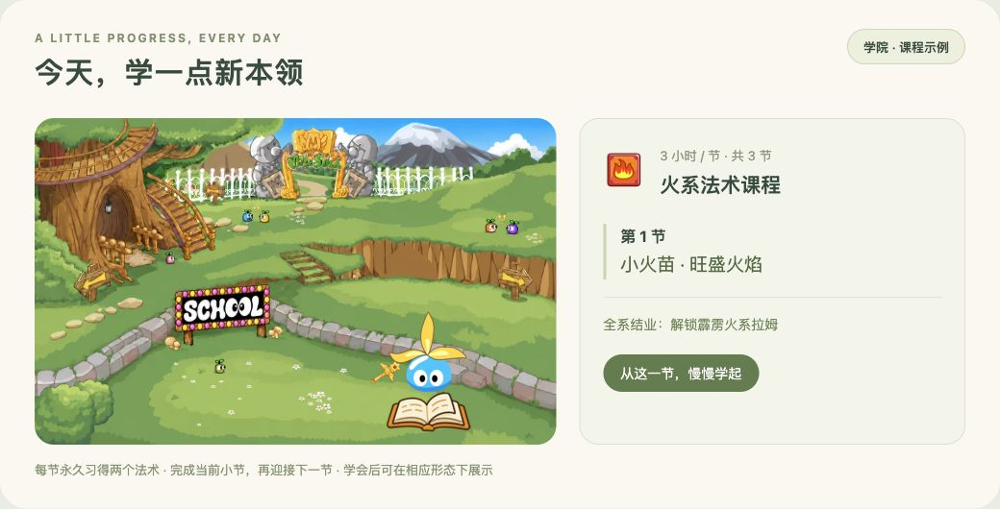
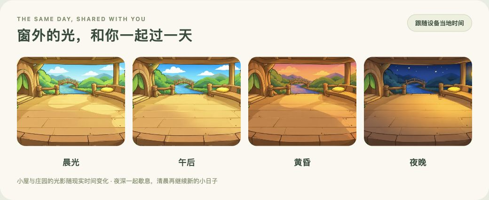

<h1 align="center">口袋拉姆 · Pocket Ramu</h1>

<b>把小小的陪伴带在身边。</b> V23.8 · 和拉姆一起长大，学会新的魔法

<a href="https://andyforfun168.github.io/ramu-pocket/"><b>🌱 开始游戏 →</b></a>　·　<a href="https://github.com/andyforfun168/ramu-pocket/releases/tag/v23.8">V23.8 版本公告</a>　·　<a href="#手机安装与更新">安装与更新</a>

无需注册 · 可添加到主屏幕 · 完整下载后离线游玩

领养一只小拉姆，为它取个名字。准备一份点心，洗个香香的澡，陪它看看蝴蝶；累了，就安心睡一会儿。你忙自己的事，它在小屋里陪着你，日子慢慢过去，叶子也慢慢长大。

## V23.8 · 长大以后，魔法开始了

从小花盆里的种子开始，经历初级、中级、高级与超级阶段，再向神力超级拉姆迈进。**成长值与健康陪伴一起积累，学会的本领和走过的日子都会留下来。**

成为超级拉姆后，完成对应的三系课程，就能切换已解锁的火、水、木系形态；成长为神力超级拉姆后，还能自由回到初级、中级、高级的模样。换外观不会重置成长与课程。

### 一节一节，学会自己的小本领

先从语言、英文和魔法入门学起，再走进火、水、木三系法术课堂。**每系三节，每节三小时，每节永久习得两个法术，共18个变身法术。** 课程只展开当前可学的一节，详细说明可以点开查看。

全系结业后解锁对应元素形态。学会的法术需要在相应元素形态，或神力超级拉姆形态下施展；演出结束，回到原来的模样。上图只展示一门课的第一节，更多变化留在游戏里发现。

### 小屋日常，也有自己的动作

喂食、洗澡、喝饮料与小互动，各有自己的照料演出。V23.8补回28组此前缺失的物品动画，并更新中级追蝴蝶动作，身体颜色随你的拉姆变化。神力及三系缺少独立完整物品原片时，共用超级拉姆的完整动作，结束后恢复当前外观。

<table><tr><td align="center" width="50%"> <b>一罐巧克力豆，吃得很认真</b> 超级拉姆 · 巧克力豆</td><td align="center" width="50%"> <b>抱住西瓜，咬一口夏天</b> 中级拉姆 · 冰镇西瓜</td></tr><tr><td align="center" width="50%"> <b>软软的面包，慢慢尝</b> 超级拉姆 · 云朵面包</td><td align="center" width="50%"> <b>喝完这瓶，再发一会儿呆</b> 初级拉姆 · 麦香牛奶</td></tr></table>

一口点心、一瓶牛奶，也有不同的小表情。上面的 GIF 来自游戏实际使用的完整动作。

## 和现实一起，从晨光走到星夜

小屋里的晨光、明亮的白昼、窗外的晚霞，再到安静的星夜，**场景会跟随设备当地的现实时间变化**。你在自己的时间里生活，拉姆也在同一片晨昏里陪着你。

学院、餐厅和淘淘乐街也有各自的日夜光景。夜深后，庄园慢慢歇息；粉红小卖部仍留着一盏暖灯，让你替熟睡的拉姆准备明天的点心。旅行中的拉姆会在外扎营，早上再继续出发。

## 去庄园，过一个自己的小日子

<table><tr><td width="50%"> <b>认真帮个小忙</b> 去餐厅送餐，赚一点摩尔豆，再给拉姆挑份喜欢的点心。</td><td width="50%"> <b>沿着灯光，逛逛庄园</b> 学院、餐厅与淘淘乐街会随当地时间变换光影。</td></tr></table>

- **背上小包去旅行**：带一点点心，从五个目的地带回礼物和见闻；夜深时在外扎营，早上继续旅程。
- **挑一个喜欢的小游戏**：接住星光、记忆翻牌、节奏拍手、点球挑战，给普通的一天添点乐趣。
- **把生活写进手记**：成长、本领、远方和小小纪念，慢慢装满你们的日子。

## 有些纪念，要一起发现

<table><tr><td align="center" width="50%"> <b>诞生奖章</b> 把第一次见面的心意留下。</td><td align="center" width="50%"> <b>睡饱饱</b> 好好休息，也值得被记住。</td></tr></table>

这两枚日常奖章，只是故事的开头。更多纪念藏在陪伴与探索里；获得以后，点开详情回顾它的来历，再挑选最多三枚陈列在小屋。尚未获得的奖章继续保留惊喜。

## 从 V22.2 到 V23.8

- **完整成长与形态权限**：完善超级、神力与三元素形态的解锁及切换规则，成长进度与当前外观分别记录。
- **三系课程与18个法术**：逐节学习、永久掌握、全系结业解锁元素外观，补齐新本领与成长的消息提醒。
- **动画与课堂显示**：恢复缺失物品动作，修正可乐身体染色、书本位置、变身烟雾覆盖及演出大小。
- **旅行与夜间生活**：旅行小包只显示持有的点心，整理按钮和说明；稀有见闻标注更明确，深夜旅行改为扎营文案。街道歇息后，粉红小卖部仍为准备物资的玩家亮灯。
- **操作与窄屏细节**：优化课程卡片、红点和胶囊按钮布局，保持原有照料、小游戏、旅行和手记玩法。

[完整版本公告 →](https://github.com/andyforfun168/ramu-pocket/releases/tag/v23.8)　·　[以往版本](https://github.com/andyforfun168/ramu-pocket/releases)

## 手机安装与更新

1. 用 iPhone / iPad 的 **Safari** 打开 [游戏网址](https://andyforfun168.github.io/ramu-pocket/)，点“分享 → 添加到主屏幕”。
2. 从新图标打开游戏，在“设置 → 离线下载与更新”下载完整资源，约 **233.9 MiB**。下载时请保持游戏在前台，中断后可以继续。
3. 看到离线就绪，再放心带着拉姆出门。电脑和其他手机浏览器也可直接通过网址游玩。

**已有拉姆？** 沿用原游戏入口，进入 **设置 → 离线下载与更新 → 检查更新**。下载完成后选择 **保存进度并打开新版**，无需清除网站数据或重新添加图标。

存档保存在当前设备的浏览器或主屏幕入口中，不自动跨设备同步。换设备、换入口或清理网站数据前，请先在设置中导出存档备份。请勿把删除网站数据当作更新步骤。

## 关于这份陪伴

本作为以《摩尔庄园》页游拉姆形象为主题的非官方个人养成小游戏，与摩尔庄园官方无关联。角色、名称、音乐及原始素材权益归各自权利人所有，部分场景与演出配件使用生成插画。感谢 [mole-baby](https://github.com/Vinci-217/mole-baby) 的素材整理；口袋拉姆与其为独立项目。
