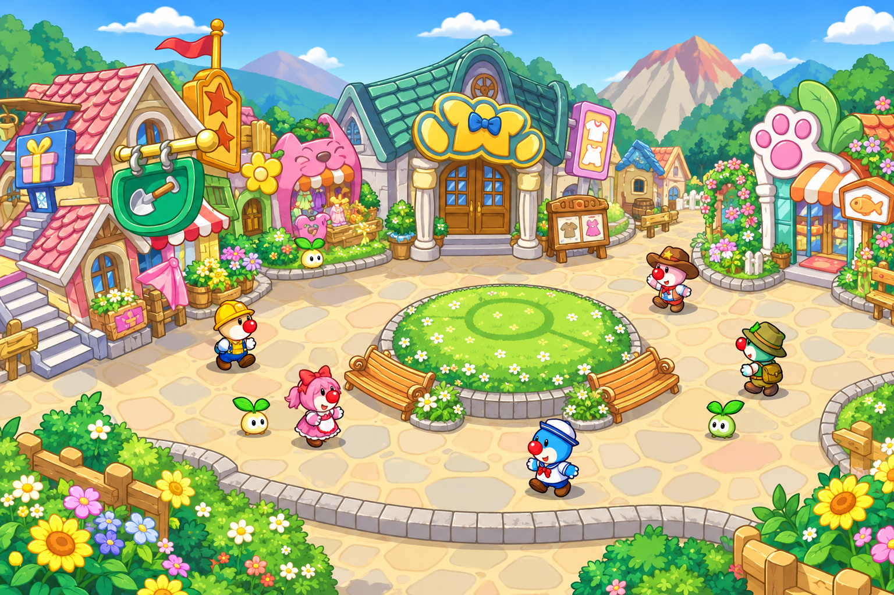
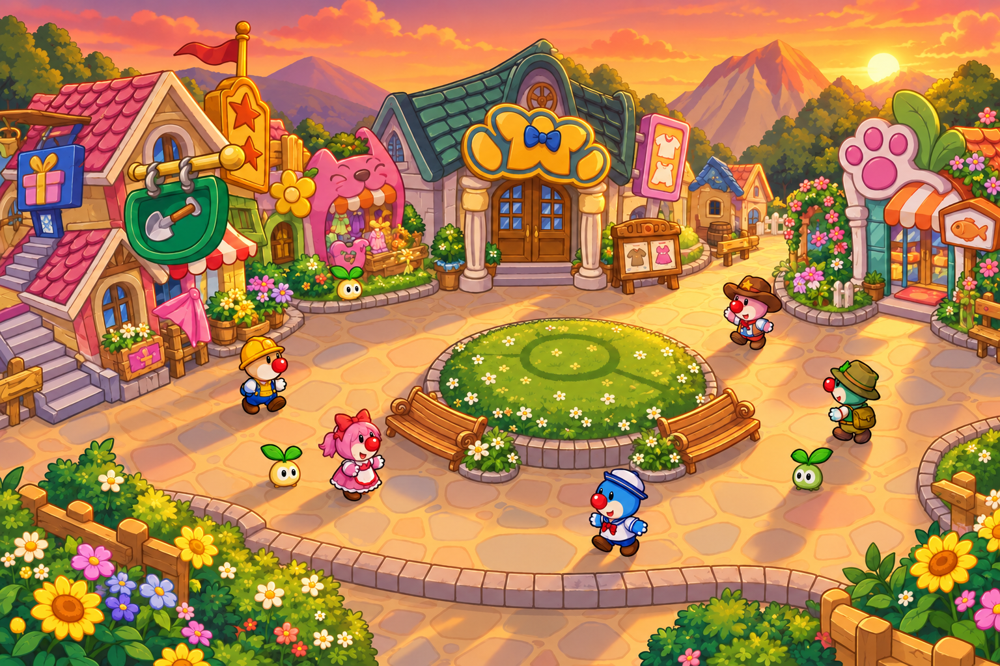
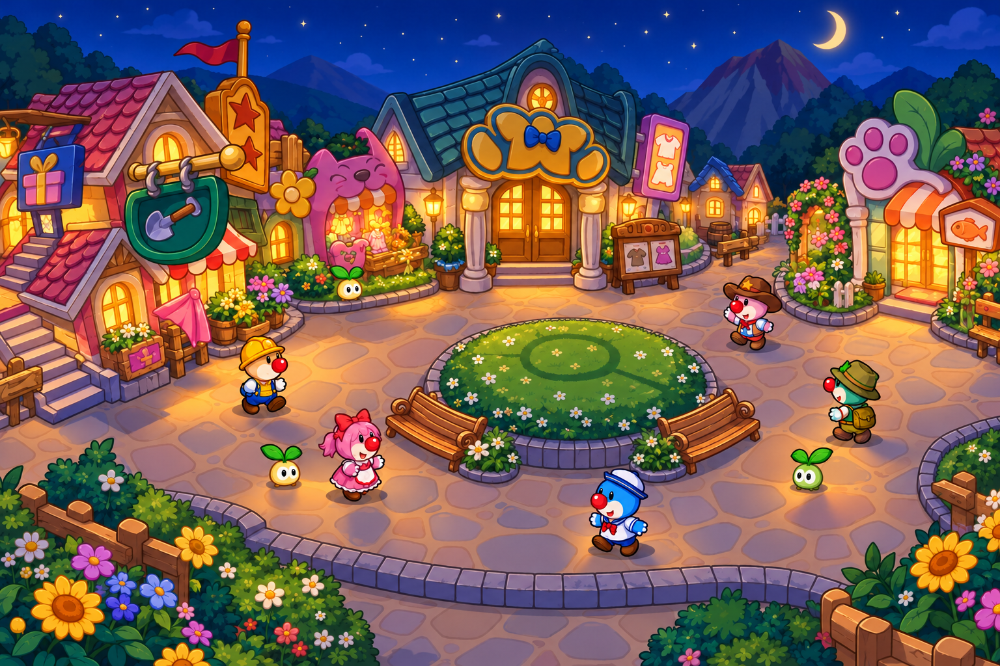
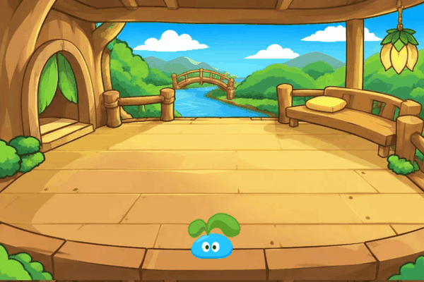
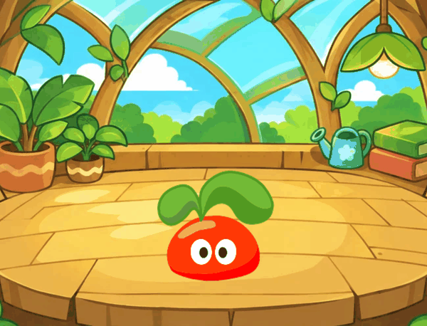
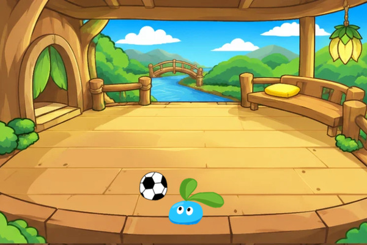
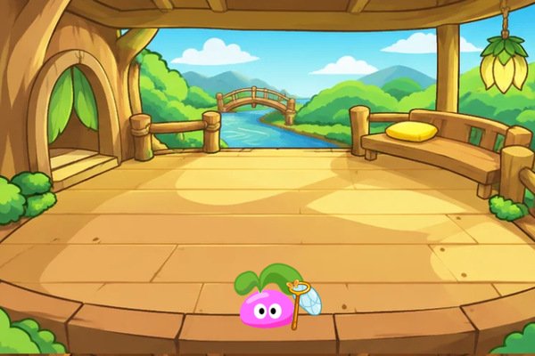
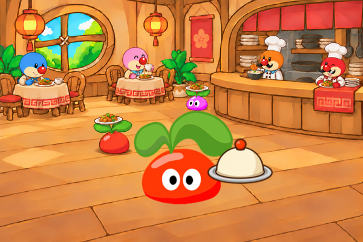
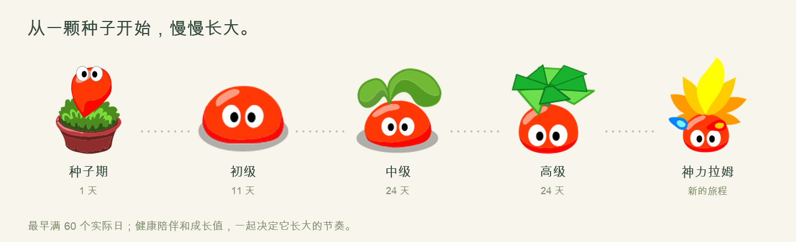
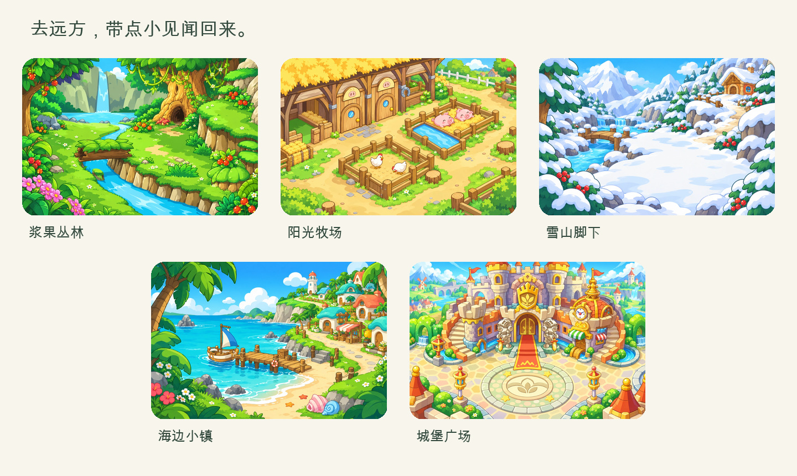

<h1 align="center">口袋拉姆 · Pocket Ramu</h1>

照料、成长、学习与旅行，一款可以随身玩的拉姆养成小游戏。

<a href="https://andyforfun168.github.io/ramu-pocket/"><b>开始游戏 →</b></a>　·　<a href="#手机安装">手机安装</a>　·　<a href="#游戏画面">游戏画面</a>　·　<a href="#v210-更新内容">更新内容</a>　·　<a href="https://github.com/andyforfun168/ramu-pocket/releases">版本下载</a>

领养一只拉姆，为它取名字，从小花盆里的种子开始照料。喂食、洗澡、休息和玩耍能帮助它保持健康，积累成长值，逐步进入新的成长阶段。

长大后的拉姆可以到学院上课、去餐厅打工，也可以出门旅行，带回礼物和见闻。游戏支持添加到手机主屏幕，下载完整资源后可离线游玩。

## 新街区与昼夜场景

<table><tr><td width="50%"></td><td></td></tr></table>

16:00 切换黄昏，20:00 切换夜景。学院与餐厅也会随当地时间变化。

## 主要玩法

| 玩法 | 内容 |
| --- | --- |
| 🌱 照料与成长 | 管理饱食、清洁、心情和精力，完成每日照料与成长任务。 |
| 🍃 互动与小游戏 | 摸摸、看蝴蝶、散步、踢足球，以及接星星、记忆翻牌、节奏拍手和点球挑战。 |
| 📚 学院课程 | 学习语言、英语和魔法，完成课程后可展示学会的本领。 |
| 🍲 餐厅打工 | 让拉姆用头顶的叶子托盘送餐，完成工作获得摩尔豆。 |
| ✉️ 旅行与收集 | 探索五个目的地，收集 30 段旅行见闻和各地的旅行家奖章。 |
| 🏅 手记与奖章 | 查看成长记录、旅行来信和已获得的 11 种奖章，选择喜欢的奖章在小屋陈列。 |

## 游戏画面

<table>
<tr>
<td width="50%"> <b>踢足球</b> 在小屋里陪拉姆活动一下。</td>
<td width="50%"> <b>看蝴蝶</b> 观察拉姆和蝴蝶互动的动作。</td>
</tr>
<tr>
<td> <b>餐厅送餐</b> 完成一份工作，赚取摩尔豆。</td>
<td> <b>小屋日常</b> 在树屋或花房里照料你的拉姆。</td>
</tr>
</table>

更多游戏画面

<table>
<tr><td width="50%"></td><td width="50%"></td></tr>
<tr><td></td><td></td></tr>
</table>

## 成长阶段

成长依次经过种子期、初级、中级、高级，最终进入神力阶段。各阶段最短时间分别为 **1 天、11 天、24 天、24 天**，达到最终阶段至少需要 60 个实际日。成长还需要足够的成长值和健康陪伴时间。

种子期的拉姆留在小屋中成长；成为初级拉姆后，开放学院、餐厅和旅行活动。

## 旅行与见闻

每个目的地有六段见闻，其中一段较为稀有。旅行可能遇到重复的见闻；集齐某个目的地的全部六段见闻后，可获得对应的旅行家奖章。

## V21.0 更新内容

每日4点刷新，夜间1:30–7:00休息；任务使用拉姆的名字，夜间睡眠时7点开放领奖。

- 庄园入口依次为学院、餐厅、淘淘乐街；我的本领移入学院，小卖部移至淘淘乐街。背包仅显示已拥有的物品，仍可一键前往小卖部。
- 餐厅、学院和淘淘乐街根据设备当地时间切换光影：16:00 黄昏、20:00 夜晚。深夜睡眠时餐厅切换为空景。
- 学院增加不同颜色的拉姆学生；玩家拉姆不在学院时显示安静场景。
- 节奏拍手按绿色区域判定，成功后移动加快、判定区域缩短。
- 小游戏奖励需达到门槛：接星星8分、翻翻乐4对、节奏拍手5次、点球3球。未达标不扣每日奖励次数。
- 种子期仅可居住在星光花房；成为初级拉姆后开放其他风景，未解锁的风景不显示预览。

以往更新记录

- 更新主屏幕图标，并同步小屋顶部的标志。
- 优化学院切换时的背景音乐加载，减少切页等待。
- 饱食、清洁、心情和精力统一显示整数。
- 旅行、餐厅打工和课程开始前显示所需属性与消耗，状态不足时提示先照料拉姆。
- 餐厅打工的最低精力调整为 40；调整长时间课程与阅读的开始要求。
- 修复跨周课程名额、夜间活动结算、阅读提示和奖章外形问题。
- 更新游戏前先保存进度；保存失败时保留当前游戏，并提示导出备份。

## 手机安装

1. 用 iPhone / iPad 的 Safari 打开 [游戏网址](https://andyforfun168.github.io/ramu-pocket/)。
2. 点击「分享 → 添加到主屏幕」。
3. 从主屏幕图标进入游戏，在「设置 → 离线下载与更新」下载完整离线资源。
4. 保持游戏在前台，下载完成后即可从同一入口离线游玩。

完整离线资源约 **249 MiB**，首次下载需要联网。下载中断后，可以从设置中继续。

### 更新已有版本

从原来的游戏入口联网打开，进入 **设置 → 离线下载与更新 → 检查更新**。如果有新版本，选择下载，完成后点击 **保存进度并打开新版**；如果无需更新，页面会显示 **已是最新版**。

更新游戏无需清除网站数据。如果桌面仍显示旧图标，可以继续从原图标游玩。需要更换图标时，请先导出存档，再从 Safari 重新添加到主屏幕；确认新入口的进度完整后，再移除旧图标。

### 保存与迁移进度

存档保存在当前设备的浏览器或主屏幕游戏入口中，不能自动跨设备同步。在设置中选择 **备份这份陪伴** 导出存档；换设备或换入口时，使用 **找回之前的存档** 导入。请在清理浏览器数据或移除旧入口前备份存档。

## 关于与致谢

口袋拉姆是一款以《摩尔庄园》页游拉姆形象为主题的非官方养成小游戏，与摩尔庄园官方无关联。角色、名称、音乐及原始游戏素材的相关权利归各自权利人所有，部分场景使用生成插画。

部分素材的整理参考了 [mole-baby](https://github.com/Vinci-217/mole-baby)，感谢其素材收集工作。口袋拉姆与 mole-baby 是两个独立项目。
