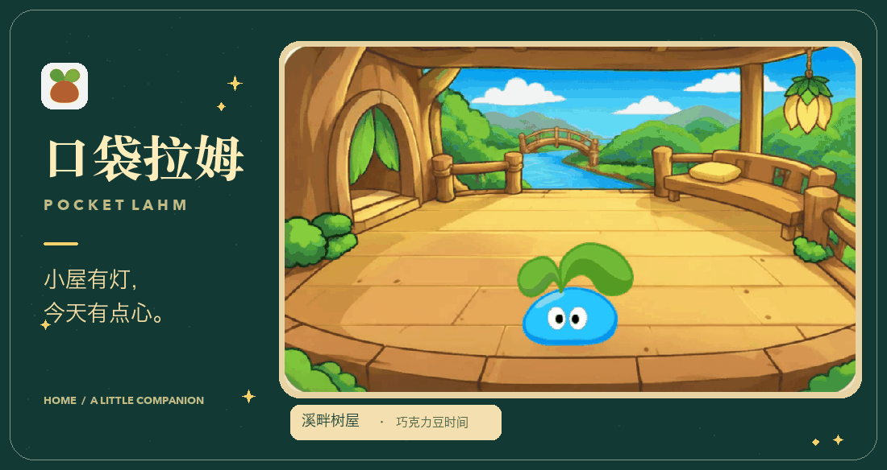

<h1 align="center">口袋拉姆 · Pocket Lahm</h1>

小屋里，有个小家伙在等你。 吃点心、去旅行，把日子慢慢记进手记。

<a href="https://github.com/andyforfun168/Lahm-pocket/releases/tag/v29.1">V29.1 更新与下载</a>　 ·　 <a href="docs/player-guide.md">手机安装与更新</a>　 ·　 <a href="docs/releases/README.md">历代更新</a>

## V29.1，活动结束时，拉姆会捎来提醒

- 可分别开启下课、打工结束和旅行返家提醒。在 iPhone 上，从主屏幕的游戏图标打开「设置 → 活动结束提醒」，点击「允许系统通知」。手机联网时可以接收推送。
- 变色药水和复色解药在兑换、使用前增加确认。游戏厅显示拉姆的当前体色，手记保留各成长阶段记录的颜色。
- 改名药水首瓶 500 摩尔豆，之后每瓶 2000 摩尔豆。

 圣诞小屋 · 黄昏。蓝色初级拉姆的奶油鬼脸匹萨时间。

[阅读 V29.1 更新说明与下载 →](https://github.com/andyforfun168/Lahm-pocket/releases/tag/v29.1)

## V29.0，走进藏宝神殿

超级拉姆可以从庄园「我的本领」进入藏宝神殿。看过火、水、木三系祭台后，等课程、形态和成长值达到条件，就能向拉姆王金像接受神力，回小屋观看变身。

### 背上小包，去新的地方

前哨站、开心农场、彩虹瀑布、咕噜艺术街和黑森林随中级拉姆开放。27 种点心有旅行特效，有的会从半路捎来消息，有的会给返家的信纸添上花纹。黑森林需要手动出发，带三种不同补给并办理保险。

<table>
<tr>
<td width="50%" align="center"> 前哨站 · 白天</td>
<td width="50%" align="center"> 开心农场 · 黄昏</td>
</tr>
<tr>
<td width="50%" align="center"> 彩虹瀑布 · 白天</td>
<td width="50%" align="center"> 黑森林 · 夜晚</td>
</tr>
</table>

### 学院、药水与照料

学院新增手工课、清泥巴课、语言课2和动物课1。手工课结业后可解锁手工涂鸦，也能在满足对应条件时兑换灰黑色变色药水和复色解药。

初级、中级或高级拉姆持续生病超过 72 小时会化为水滩，可用复活十字架唤醒。第一次化为水滩时会获得「向死而生」纪念章。

[阅读 V29.0 完整更新说明与下载 →](https://github.com/andyforfun168/Lahm-pocket/releases/tag/v29.0)

## 关于这份陪伴

感谢摩尔庄园，为许多小摩尔的童年留下一处温暖的港湾。以前的小摩尔如今长大了，希望这份小小的陪伴，仍能在忙完一天以后，留一盏可以回家的灯。

这是以《摩尔庄园》页游拉姆形象为主题的非官方个人养成小游戏，与官方无关联。角色、名称、音乐及原始素材权益归各自权利人所有，部分场景与演出配件使用生成插画。感谢 [mole-baby](https://github.com/Vinci-217/mole-baby) 的素材整理。口袋拉姆与其为独立项目。

慢慢长大，慢慢学会。愿你喜欢这份小小的陪伴。

