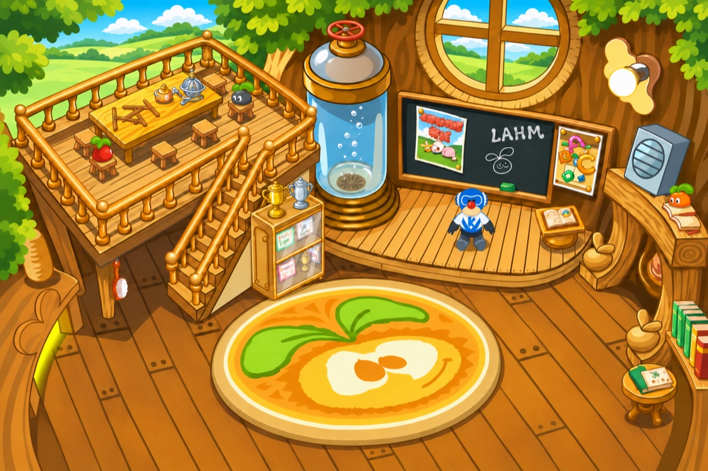
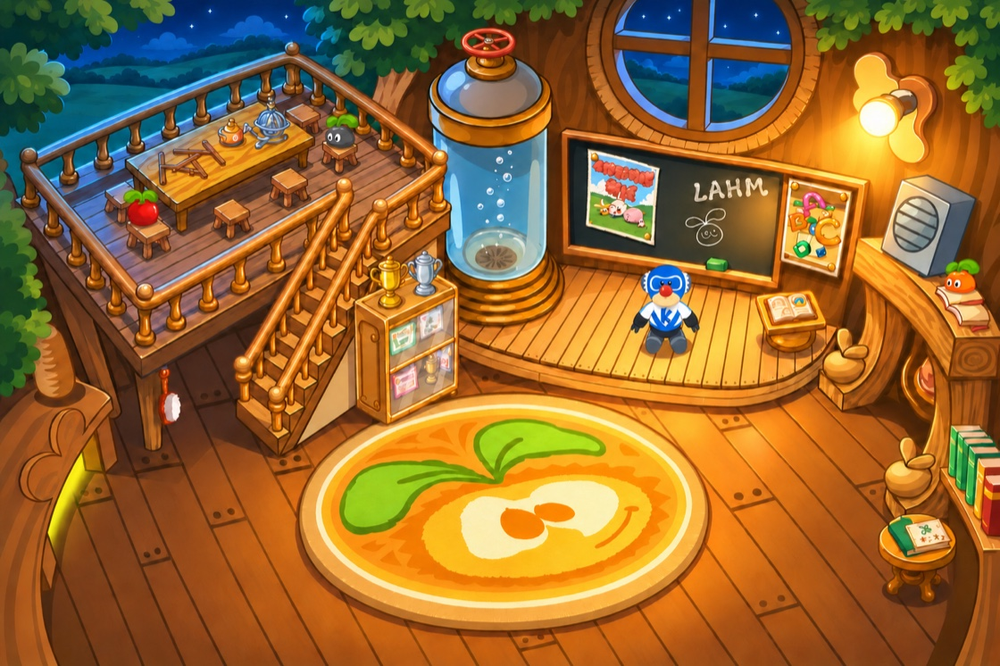
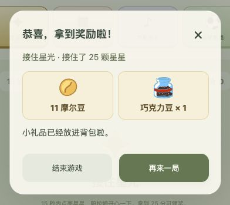
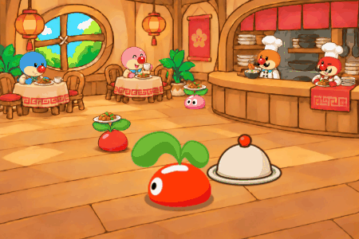
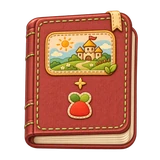
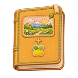
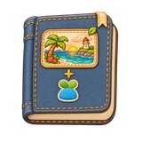
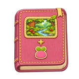

<h1 align="center">口袋拉姆 · Pocket Lahm</h1>

小屋里，有个小家伙在等你。 吃点心、去旅行，把日子慢慢记进手记。

<a href="https://github.com/andyforfun168/Lahm-pocket/releases/tag/v28.8">V28.8 更新与下载</a>　 ·　 <a href="docs/player-guide.md">手机安装与更新</a>　 ·　 <a href="docs/releases/README.md">历代更新</a>

## V28.8，给小屋换个风景

猎人小屋添了木椅与地图桌，漂流瓶小屋能望见云下的河，梦幻魔力小屋在藤蔓间铺好了软毯。圣诞小屋也换了红木墙、大雪窗和新地毯。每间小屋都会随时间换光。

<table>
<tr>
<td width="50%" align="center"> 漂流瓶小屋 · 清晨</td>
<td width="50%" align="center"> 梦幻魔力小屋 · 白天</td>
</tr>
<tr>
<td width="50%" align="center"> 猎人小屋 · 黄昏</td>
<td width="50%" align="center"> 圣诞小屋 · 夜晚</td>
</tr>
</table>

[阅读 V28.8 更新说明与下载 →](https://github.com/andyforfun168/Lahm-pocket/releases/tag/v28.8)

## V28.5，把旅行惊喜带回家

每趟完整旅行带回一段见闻：普通 **97%**、稀有 **2%**、黄金 **1%**。小屋红点打开的旅行来信，与手记和收藏册里的是同一张。

<table><tr>
<td width="50%" align="center"> 海边小镇</td>
<td width="50%" align="center"> 雪山脚下</td>
</tr></table>

每地第 **12** 趟保底首条稀有，第 **16** 趟保底首条黄金；自然抽到会满足对应保底。从未拿过黄金的玩家，完整旅行累计至少 **40** 趟、到访至少 **5** 个不同地方时，会带回当前目的地的首金。原有五个目的地和收藏进度继续保留。

[阅读完整 V28.5 更新说明与下载 →](https://github.com/andyforfun168/Lahm-pocket/releases/tag/v28.5)

## V28.2，回到拉姆课堂

白天，阳光照进树屋；夜里，窗外亮起星星，教室里也点起了灯。基础课程现在在凯文的拉姆课堂上，场景会随当地时间变化。

<table><tr>
<td width="50%" align="center"> 白天 · 阳光下的课堂</td>
<td width="50%" align="center"> 夜晚 · 灯亮了</td>
</tr></table>

结业后，语言课1、英语课和魔法入门课的证书会收进「我的本领」的木质展示架。点开证书，可以放大细看，也能重温菩提大伯和葡萄的祝贺。

<table><tr>
<td width="33%" align="center"> 语言课1</td>
<td width="33%" align="center"> 英语课</td>
<td width="33%" align="center"> 魔法入门课</td>
</tr></table>

小屋的「小动作」和「小本领」也搬到了一组页签里，随时可以切换，给小屋腾出一点空间。

### V28.2 游戏厅更新

现在每局只需 **1 摩尔豆**，达标可得 **11 摩尔豆**。四个小游戏共用每日 5 次领奖机会，每次领奖有 **40%** 的机会收到小礼品。前四次都没收到，第五次领奖会送一份。翻翻乐前 15 秒配齐可领奖，节奏拍手在 15 秒内不限拍数，拿到 5 分就达标。

[阅读完整 V28.2 更新说明与下载 →](https://github.com/andyforfun168/Lahm-pocket/releases/tag/v28.2)

## 把小小的陪伴，装进口袋

领养一只小拉姆，从花盆里的陪伴开始。喂点心、洗香香，陪它看看蝴蝶、踢踢球；慢慢长大以后，还能去学院学本领、在餐厅帮忙，或背上小包去庄园走走。

<table><tr>
<td width="50%" align="center"> 喝完牛奶，再陪你发会儿呆。</td>
<td width="50%" align="center"> 系好围裙，认真帮个小忙。</td>
</tr></table>

场景跟着当地时间从晨光走到星夜。四种颜色的拉姆有自己的小性格，也会用自己的口吻，把陪伴写进手记。

## V28.0，把小风景珍藏起来

一本织布收藏册，收好路上遇见的小惊喜。细细的布纹、撞色缝线与小布贴，跟随拉姆当前的体色。

番茄红 · 奶油黄 · 天空蓝 · 莓莓粉

- **轻点封面，翻开远方。** 每页四张旅行卡，最多十页；完整见闻汇总一直保留。种子期也有一本等待装满的空册子。这次补充统一了有卡、空卡与封面的尺寸，翻页不再忽长忽短。
- **轻度陪伴，也能稳稳长大。** 每健康陪伴一小时自动获得10点成长，离线也会累计；高级拉姆到超级拉姆的成长值门槛降至4,000。原有阶段、成长与课程进度保留。
- **读起来、点起来，更舒服。** 设置可选标准／较大字号；任务要求更清楚，餐厅换上手写木牌。手记先看最近的纪念和风景，更多日子留待展开。

在旅行途中，熟悉的小路上还藏着一些更特别的黄金见闻。先留一点神秘，等拉姆到家后亲自讲给你听。

[阅读完整 V28.0 更新说明 →](docs/releases/RELEASE-v28.0.md)

## 手机安装与更新

1. 用 Safari 打开[游戏](https://andyforfun168.github.io/Lahm-pocket/)，选择「分享 → 添加到主屏幕」。
2. 从图标进入，在「设置 → 离线下载与更新」下载资源；完成后即可离线陪伴。
3. 老玩家沿用原入口更新，下载后选择「保存进度并打开新版」，无需清除网站数据。

联网时，游戏会轻量检查版本，首次发现新版就会居中提醒。选择「暂不更新」后，同一新版从次日当地时间凌晨 4 点起再次提醒。进度保存在当前设备，换设备或清理浏览器前，请先在设置中导出备份。

[安装、更新与存档说明 →](docs/player-guide.md)

## 小屋走过的日子

每一次新场景、每一段小手记，都留下了一点这间小屋的变化。旧公告、旧配图和下载仍然保留，只把它们收进了更好找的地方。

[历代更新与下载](docs/releases/README.md)　 ·　 [旧版完整图文介绍](docs/archive/README-before-v28-cleanup.md)　 ·　 [反馈与建议](https://github.com/andyforfun168/Lahm-pocket/issues)

## 关于这份陪伴

感谢摩尔庄园，为许多小摩尔的童年留下一处温暖的港湾。以前的小摩尔如今长大了，希望这份小小的陪伴，仍能在忙完一天以后，留一盏可以回家的灯。

这是以《摩尔庄园》页游拉姆形象为主题的非官方个人养成小游戏，与官方无关联。角色、名称、音乐及原始素材权益归各自权利人所有，部分场景与演出配件使用生成插画。感谢 [mole-baby](https://github.com/Vinci-217/mole-baby) 的素材整理；口袋拉姆与其为独立项目。

慢慢长大，慢慢学会。愿你喜欢这份小小的陪伴。

