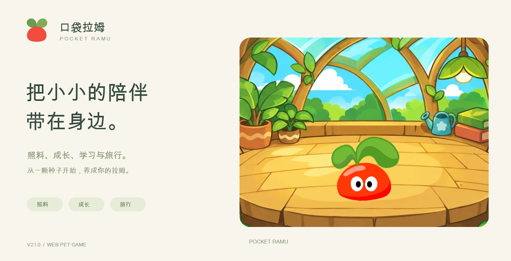
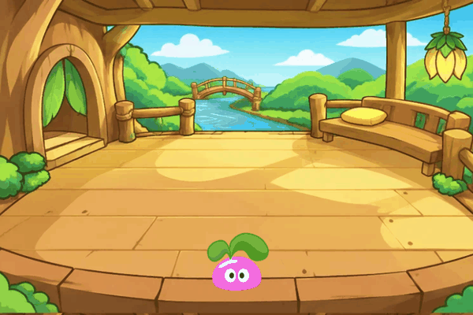

<h1 align="center">口袋拉姆 · Pocket Ramu</h1>

<b>V22.2 · 小屋之外，藏着新的惊喜</b> 把小小的陪伴带在身边，和拉姆一起过好普通的一天。

<a href="https://andyforfun168.github.io/ramu-pocket/"><b>🌱 开始游戏 →</b></a>　·　<a href="https://github.com/andyforfun168/ramu-pocket/releases/tag/v22.2">V22.2 版本公告</a>　·　<a href="#手机安装与更新">手机安装</a>

领养一只小拉姆，为它取个名字。轻轻摸摸，准备一份点心，洗个香香的澡；累了就睡一会儿。你忙自己的事，它在小屋里陪着你，日子慢慢过去，叶子也慢慢长大。

口袋拉姆是一款无需注册、可添加到手机主屏幕的养成小游戏。完整下载后，可以从同一入口离线游玩。

## 这一回，去庄园逛逛

**学院、餐厅、淘淘乐街**，连成了拉姆的小小日常。上完一节课，学会的本领可以展示给你看；结业后也能回课堂复习。去餐厅帮忙送餐，再拿赚来的摩尔豆逛逛小卖部，看看今天遇见了什么好东西。

街道与学院会随设备当地时间变换光影。下午的暖光、夜里的灯火，都是同一个庄园不同的模样。

<table><tr><td width="50%"> <b>今天，去帮个小忙</b> 托好叶子上的餐盘，认真完成一份工作。</td><td width="50%"> <b>也可以，什么都不赶</b> 在小屋里看看蝴蝶，陪它发一会儿呆。</td></tr></table>

## 小屋里，还有这些好玩的事

| 想做点什么 | 和拉姆一起 |
| --- | --- |
| 🌱 慢慢长大 | 从小花盆开始照料，收集成长与陪伴的记录，迎接新的模样。 |
| 💛 来点互动 | 点击小屋里的拉姆摸摸它，或按“互动”看它随机做个动作；玩累了，就休息一小会儿。 |
| ✨ 玩一局 | 接住星光、记忆翻牌、节奏拍手、点球挑战，挑一个喜欢的小游戏。 |
| ✉️ 背上小包 | 去五个目的地看看。完整旅行结束后，把礼物和见闻带回家，慢慢装满自己的收藏册。 |
| 📖 留住小日子 | 翻开手记，看看它学过的本领、到过的远方，以及你们一起经历的事。 |

## 有些纪念，要一起发现

有不同的精美奖章，等待玩家和拉姆一起集齐、搜寻～

惊喜藏在共同生活的日常里。获得一枚以后，点开详情，才能回顾它为何来到你的小屋；再挑选最多三枚，摆在拉姆身边。

## V22.2 带来了什么

**与上一个公开版本 V21.1 相比：**

- **陪伴更顺手**：主按钮调整为“喂食、洗澡、互动、睡觉”，与四项状态对应。新增随机互动，每次消耗2点精力，连续5次后休息15秒；点击小屋摸摸的操作保留。
- **新消息更好找**：任务、来信、奖章和本领分别提醒；再次点击有红点的当前导航，可以定位到对应区域。
- **成长看得更明白**：按当前阶段显示陪伴进度，校准阶段成长值与时间；中级到高级的阶段陪伴要求为24天。
- **奖章与小屋陈列更新**：完善奖章美术与判定，加入更多等待探索的纪念。未获得前保留秘密，小屋最多陈列三枚，长文案会在自己的区域换行。
- **复习前先看明白**：“复习一遍 ⓘ”可查看时长、消耗、奖励和当前限制；确认后才开始课程。
- **旅行说明更完整**：提前返家不会带回礼物或见闻，也不计成功到访；完整旅行按原规则结算。
- **庄园与音乐细节优化**：调整淘淘乐街三只小拉姆的外形、颜色和表情；每首背景音乐完整播放5遍后再换曲，切页继续播放。
- **小游戏与运行修复**：接星星领奖目标调整为25分、点球为8分；优化动画资源复用与前后台恢复，修复离线更新版本显示、面板滚动起点和存档清除后的边界错误。

[查看完整版本公告 →](https://github.com/andyforfun168/ramu-pocket/releases/tag/v22.2)　·　[以往版本](https://github.com/andyforfun168/ramu-pocket/releases)

## 手机安装与更新

1. 用 iPhone / iPad 的 **Safari** 打开 [游戏网址](https://andyforfun168.github.io/ramu-pocket/)。
2. 点“分享 → 添加到主屏幕”，再从新图标打开游戏。
3. 进入“设置 → 离线下载与更新”，下载完整离线资源。首次约 **228.4 MiB**，请在完成前保持页面在前台；中断后可以继续。

**已有拉姆？** 从原入口联网打开，进入“设置 → 离线下载与更新 → 检查更新”。下载完成后，选择“保存进度并打开新版”，无需清除网站数据。

存档保存在当前设备的浏览器或主屏幕入口中。换设备、换入口或清理网站数据前，请先在设置里导出存档备份，再在目标入口导入。主屏幕图标的刷新时间由设备决定。

## 关于这份陪伴

本作为以《摩尔庄园》页游拉姆形象为主题的非官方个人养成小游戏，与摩尔庄园官方无关联。角色、名称、音乐及原始素材权益归各自权利人所有，部分场景使用生成插画。感谢 [mole-baby](https://github.com/Vinci-217/mole-baby) 的素材整理工作；口袋拉姆与其为独立项目。
