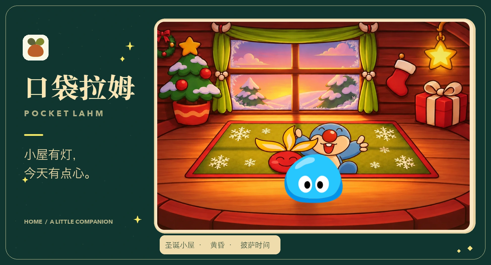
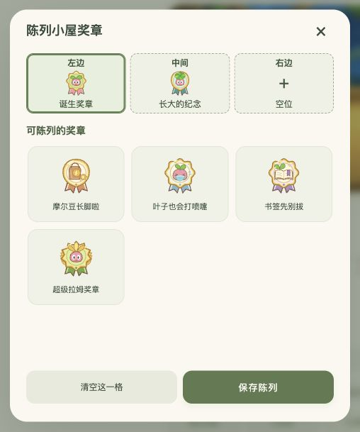
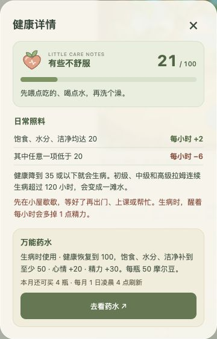
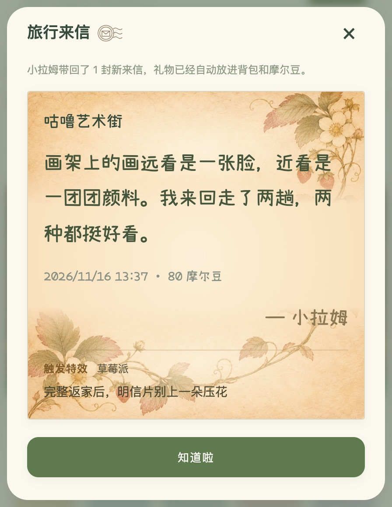
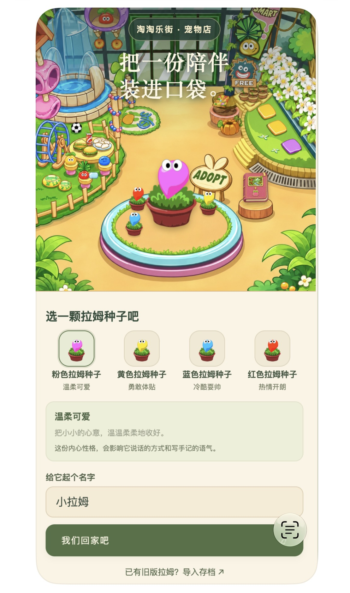

<h1 align="center">口袋拉姆 · Pocket Lahm</h1>

小屋里，有个小家伙在等你。 吃点心、去旅行，把日子慢慢记进手记。

<a href="https://github.com/andyforfun168/Lahm-pocket/releases/tag/v29.6">V29.6 更新与下载</a>　 ·　 <a href="docs/player-guide.md">手机安装与更新</a>　 ·　 <a href="docs/releases/README.md">历代更新</a>

## V29.6 精致小屋与旅行更新

新增精致小屋主题、薄荷绿变色药水和随体色变化的六款背包。重新整理了出发窗口与新手指引，健康值高于 40 时累计健康陪伴，并缩小了动画与离线资源。

[阅读 V29.6 更新说明与下载 →](https://github.com/andyforfun168/Lahm-pocket/releases/tag/v29.6)

## V29.5.1 小屋动画修复

214 个小屋动画入口换用五色高清帧图，保留原先取景，修复 iPhone Safari 播放时可能出现的白屏或重载。

网页版重新打开原地址即可。已安装离线版的玩家请先联网，在游戏内打开「离线与更新」，下载并切换到新版，存档会继续使用。

[阅读 V29.5.1 修复说明与下载 →](https://github.com/andyforfun168/Lahm-pocket/releases/tag/v29.5.1)

## V29.5，成长、动画与奖章陈列

- 成长｜种子、初级、中级、高级分别累计 24 小时、8 天、16 天、16 天健康陪伴，并达到本阶段 220、2,000、4,000、4,000 成长值。手记显示健康陪伴进度。
- 课程｜语言课1和英语课各 3 节 × 3 小时，语言课2为 5 节 × 2 小时，火、水、木三系法术课各 3 节 × 5 小时。
- 动画｜更新初级 34 段、中级 33 段、高级 36 段。修正体色、取景和首尾衔接，跳跳布丁前四秒锁定镜头，高级拉姆摸摸时会向右倾身。
- 奖章｜新奖章自动上墙，三格满时替换最右一枚。可从奖章详情选左、中、右位置，保存后回小屋。
- 照护｜初级、中级、高级连续生病超过 3 天（72 小时）会变成水滩，离线也计时。修复开心果在喂食列表漏显示的问题。

选好位置，再挑一枚奖章挂进小屋。

[阅读 V29.5 更新说明与下载 →](https://github.com/andyforfun168/Lahm-pocket/releases/tag/v29.5)

## V29.3.1，照护修复

万能药水和复活十字架各售 50 摩尔豆。使用后健康恢复到 100，饱食、水分、洁净补到至少 50。

初级、中级和高级拉姆连续生病超过 5 天（120 小时）才会变成水滩，离线也计时。「向死而生」在第一次变成水滩时获得。

在小屋的「健康详情」查看照护方式。

### 旅行信纸

四款旅行信纸的花纹在窄屏上也按原比例显示。手记和收藏册里的卡片底纹略微加深。

旅行来信里的草莓压花信纸。

### 通知文案修复

联网打开新版时，游戏会更新通知脚本，让餐厅打工和小助教结束提醒显示各自的新文案。

[阅读 V29.3.1 修复说明与下载 →](https://github.com/andyforfun168/Lahm-pocket/releases/tag/v29.3.1)

## V29.3，去宠物店遇见拉姆

第一次打开游戏，可以从全屏引导直接走进淘淘乐街宠物店。选四种拉姆种子时，点一下旁边的小本子，就能放大看对应的见闻收藏册封面。

在淘淘乐街选一颗拉姆种子，再给它取个名字。

见闻收藏册底部有「见闻汇总」和「小屋手记」两张便签，读完可以回到刚才那一页。小屋手记最多保留 100 条。餐厅打工和小助教结束各有自己的推送文案。

[阅读 V29.3 更新说明与下载 →](https://github.com/andyforfun168/Lahm-pocket/releases/tag/v29.3)

## V29.2，借一点风去旅行

高级拉姆可以上飞行课。领证后，在小屋试试「滑翔一小段」，也可以在手动出游前借一点风。普通路线少走 10 分钟，黑森林少走 20 分钟，每天共可用两次。

课程结业后，可以到校长办公室领取证书。

初级陪伴满 8 天并达成健康陪伴和成长值条件后，可升到中级。英语课也提前到初级开放。旅行返家休息 3～4 小时，设置可开启「可以再次出游」提醒。

[阅读 V29.2 更新说明与下载 →](https://github.com/andyforfun168/Lahm-pocket/releases/tag/v29.2)

## V29.1.1，背景音乐修复

游戏前台的背景音乐意外暂停后，会尝试从原进度续播。

[阅读 V29.1.1 更新说明与下载 →](https://github.com/andyforfun168/Lahm-pocket/releases/tag/v29.1.1)

## V29.1，活动结束时，拉姆会捎来提醒

- 可分别开启下课、打工结束和旅行返家提醒。在 iPhone 上，从主屏幕的游戏图标打开「设置 → 活动结束提醒」，点击「允许系统通知」。手机联网时可以接收推送。
- 变色药水和复色解药在兑换、使用前增加确认。游戏厅显示拉姆的当前体色，手记保留各成长阶段记录的颜色。
- 改名药水首瓶 500 摩尔豆，之后每瓶 2000 摩尔豆。

[阅读 V29.1 更新说明与下载 →](https://github.com/andyforfun168/Lahm-pocket/releases/tag/v29.1)

## V29.0，走进藏宝神殿

超级拉姆可以从庄园「我的本领」进入藏宝神殿。看过火、水、木三系祭台后，等课程、形态和成长值达到条件，就能向拉姆王金像接受神力，回小屋观看变身。

### 背上小包，去新的地方

前哨站、开心农场、彩虹瀑布、咕噜艺术街和黑森林随中级拉姆开放。27 种点心有旅行特效，有的会从半路捎来消息，有的会给返家的信纸添上花纹。黑森林需要手动出发，带三种不同补给并办理保险。

<table>
<tr>
<td width="50%" align="center"> 前哨站 · 白天</td>
<td width="50%" align="center"> 开心农场 · 黄昏</td>
</tr>
<tr>
<td width="50%" align="center"> 彩虹瀑布 · 白天</td>
<td width="50%" align="center"> 黑森林 · 夜晚</td>
</tr>
</table>

### 学院、药水与照料

学院新增手工课、清泥巴课、语言课2和动物课1。手工课结业后可解锁手工涂鸦，也能在满足对应条件时兑换灰黑色变色药水和复色解药。

初级、中级或高级拉姆持续生病超过 72 小时会化为水滩，可用复活十字架唤醒。第一次化为水滩时会获得「向死而生」纪念章。

[阅读 V29.0 完整更新说明与下载 →](https://github.com/andyforfun168/Lahm-pocket/releases/tag/v29.0)

## 关于这份陪伴

感谢摩尔庄园，为许多小摩尔的童年留下一处温暖的港湾。以前的小摩尔如今长大了，希望这份小小的陪伴，仍能在忙完一天以后，留一盏可以回家的灯。

这是以《摩尔庄园》页游拉姆形象为主题的非官方个人养成小游戏，与官方无关联。角色、名称、音乐及原始素材权益归各自权利人所有，部分场景与演出配件使用生成插画。感谢 [mole-baby](https://github.com/Vinci-217/mole-baby) 的素材整理。口袋拉姆与其为独立项目。

慢慢长大，慢慢学会。愿你喜欢这份小小的陪伴。

