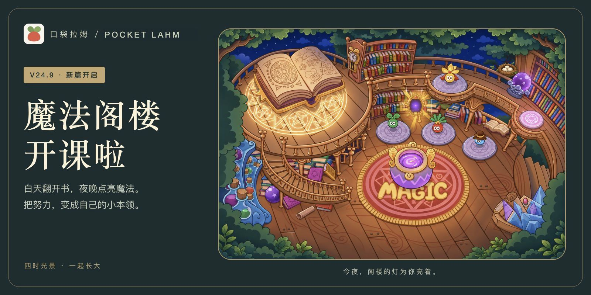
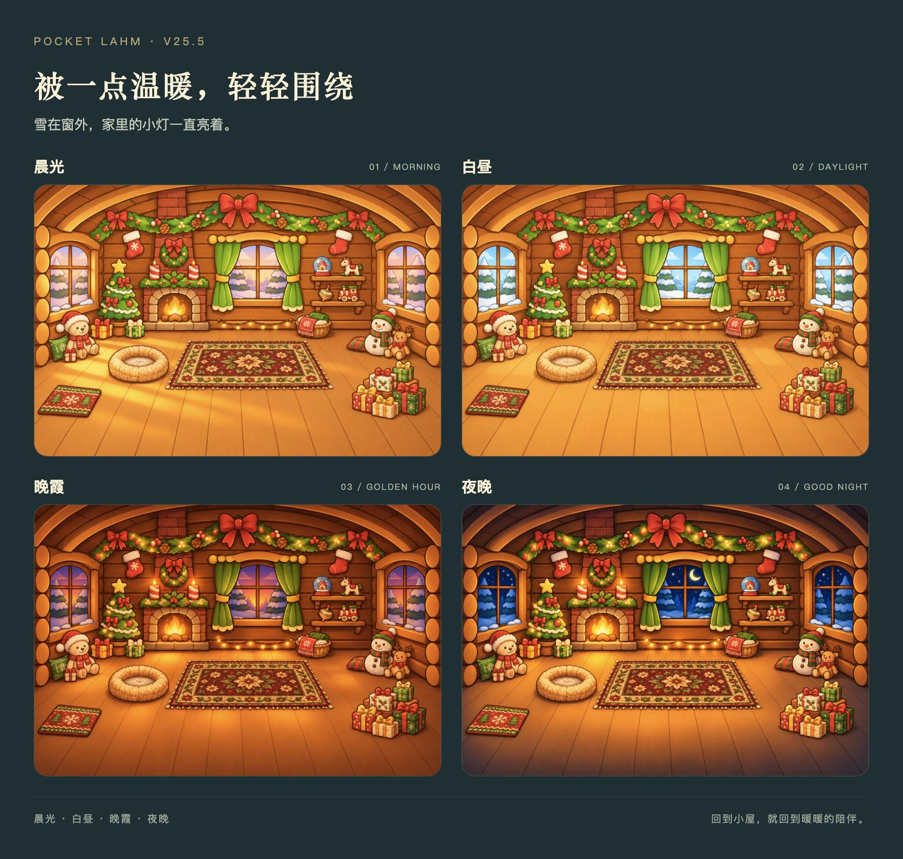
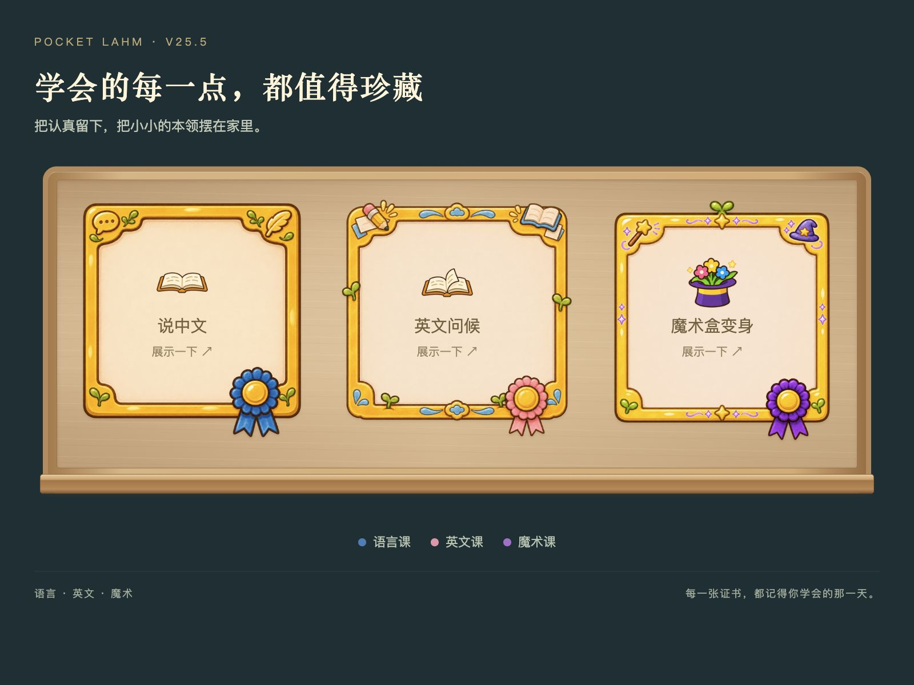
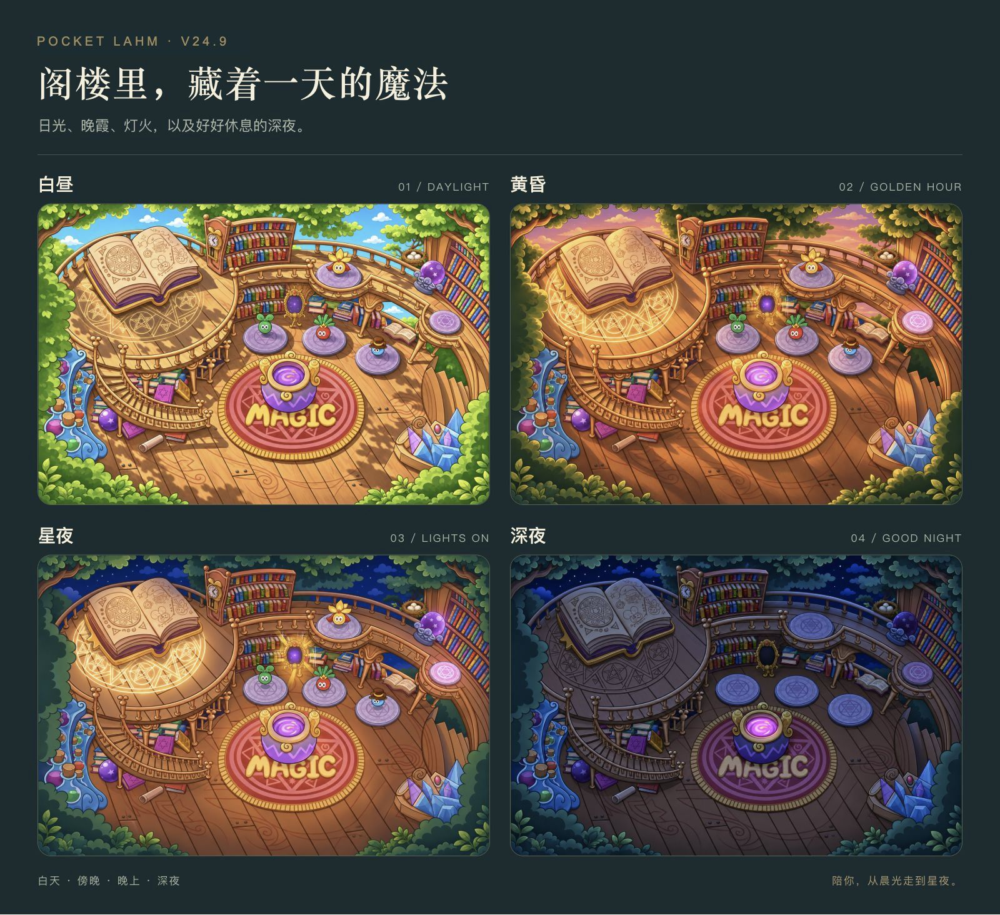
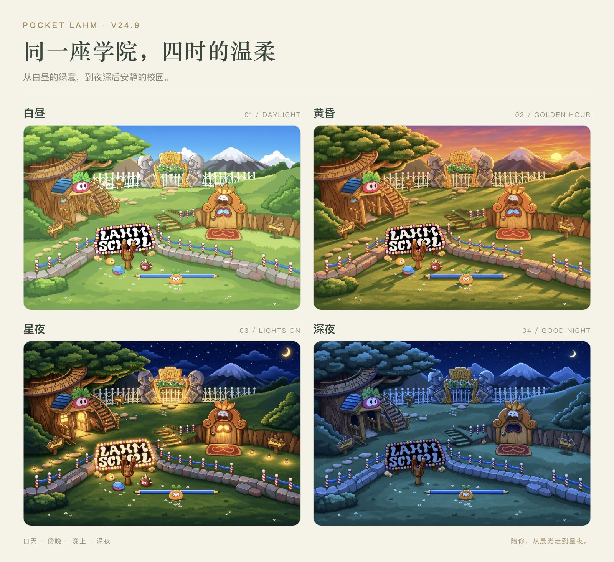
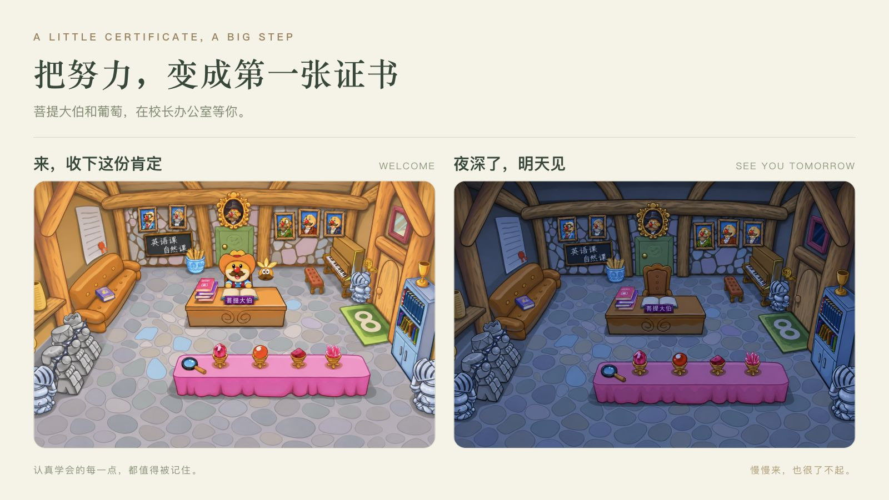

<b>口袋拉姆 · V25.5 暖暖的小日子</b> 圣诞小屋、收藏证书与成长奖章

沿着熟悉的校园，再往前走一点。

熟悉的魔法阁楼和校长办公室，继续陪你学一点新本领。这个版本也为小屋添上一点暖意，把认真学会的每一点本领，变成值得收藏的小小纪念。

<a href="https://andyforfun168.github.io/Lahm-pocket/"><b>🌱 带拉姆走进新篇章 →</b></a>　·　<a href="https://github.com/andyforfun168/Lahm-pocket#readme">看看更多日常</a>

## ✦ 回家，被一点温暖围绕

圣诞小屋加入毛茸茸的小窝、复古地毯、红绿小门毯与礼物堆。晨光、白昼、晚霞、夜晚四种光景，让同一个家有了不同的温度。

晨光书房在初级阶段开放，溪畔树屋和圣诞小屋在中级阶段开放，用摩尔豆永久解锁，喜欢的风景可以一直住下去。

## ✦ 本领和成长，收进小小收藏

三门基础课的结业证书换上金色方框、蓝粉紫绶带与木质展示柜。学会魔术盒变身后，小家伙偶尔会自己变个小魔术，也会说一句属于这份惊喜的话。

新增三片金叶的超级拉姆奖章；神力奖章有七片叶子和悬在身旁的红绿蓝小球。奖章中的拉姆，依然跟随你为它挑选的颜色。

<table><tr><td align="center" width="25%"> <b>诞生奖章</b></td><td align="center" width="25%"> <b>睡饱饱</b></td><td align="center" width="25%"> <b>超级拉姆奖章</b></td><td align="center" width="25%"> <b>神力奖章</b></td></tr></table>

## ✦ 陪伴的小动作，再多一点

新增逗逗拉姆一、二、三，魔法弹簧和乐刷刷五组完整玩耍动作。小屋可以按自己的喜好挑七个动作，没选满时会随机补齐；互动时也有机会遇见新动作。看蝴蝶加入日常待机，旅行来信换上带着轻微水渍的手写信纸，每一次见闻都署上拉姆的名字。

## ✦ 阁楼的灯，亮起来了

日光下的书页，晚霞里的木楼梯，星夜中亮起的法阵与水晶。**魔法阁楼有了白天、傍晚、晚上和深夜四种光景**，陪你从晨光走到星夜。

从基础课开始，一节一节掌握自己的小本领，再走进火、水、木三系课堂。夜深后，老师们离场休息，魔法锅的锅身保持深夜暗色，紫色药水照亮锅口，周围木地板留着柔和的光晕，安静地等明天再见。

## ✦ 学院，也有自己的一天

熟悉的校门、树屋和草地，白天明亮，傍晚温暖，入夜后亮起小灯，深夜再慢慢歇息。景色跟随设备当地时间变化，每次回到校园，都能遇见当时的光。

## ✦ 来，收下你的第一张证书

**完成基础课后，到校长办公室领取结业证书。** 菩提大伯和葡萄在那里，为认真学习的你留下这份肯定。

已经结业的课程，还可以回来当小助教，陪别人学一会儿，完成后获得摩尔豆。慢慢学会的本领，也能成为帮到别人的力量。

## ✦ 日常的小地方，也更顺手了

- 上课前多一层确认，避免误触；学会元素法术后，可从对应系别入口确认切换形态。
- 旅行小包确认后保留小屋的浏览位置，旅途见闻与礼物卡的排版更整齐。
- 修复高级拉姆物品互动的镜头抖动，保留完整原片；清凉草莓浴液也有更稳定的画面。
- 清醒17小时自然减少50精力。清凉草莓浴液增加10精力，原价调整为30摩尔豆。
- 四种小游戏分别记录永久最高分；点球挑战20秒内可以继续射门。
- 深夜的魔法阁楼仍然无人，锅身保持深夜暗色，紫色药水照亮锅口，周围地板有柔和光晕。

## 带着原来的拉姆，继续往前走

从原入口打开 **设置 → 离线下载与更新 → 检查更新**，下载后选择 **保存进度并打开新版**。名字、成长、背包和已有本领会陪你一起走进新篇章，无需清除网站数据。

手机安装、下载与存档

首次游玩可用Safari打开游戏，添加到主屏幕，再从图标进入完成离线下载。完整资源约387.8 MiB，下载时保持页面在前台，中断后可以继续。

若旧入口下载完成后仍显示“下载新版”，再检查一次更新即可刷新就绪状态。更换设备或清理网站数据前，请在设置中导出存档备份。

<b>每一份努力，都值得被记住。 祝你和拉姆，在新的一天里学会一点本领，也留一点时间发呆。</b>

