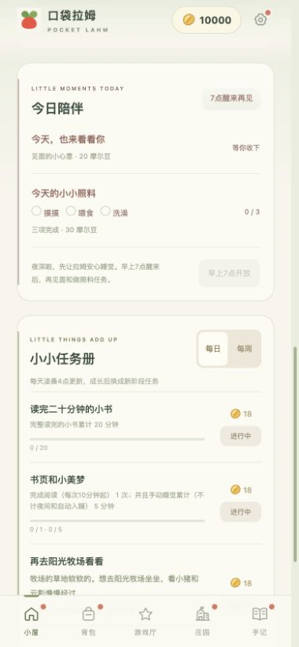
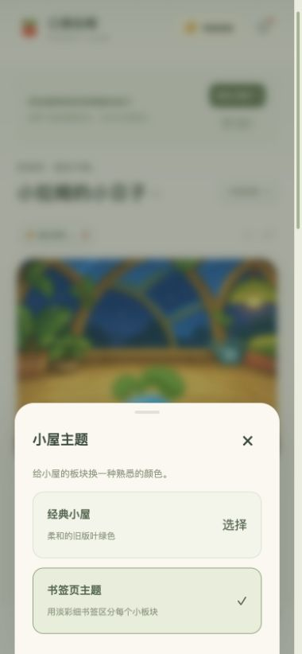

## V27.0 体验修复

- 更新说明会在启动准备完成后显示，已有拉姆不再重复弹出首次安装或「下载好了」引导。
- 新增设置入口会用独立红点指路，主题和音乐快捷按钮都能找到，查看后不反复提醒。
- 旅行小贴士、来信、稀有见闻和奖章分别提醒，不会再互相影响已读状态。
- 接入已确认的中级拉姆雪顶椰汁动画：先向左走、站定后喝，修复身体底部发白。

## 小屋的新手记

[打开游戏](https://andyforfun168.github.io/Lahm-pocket/) · [手机安装与更新](https://github.com/andyforfun168/Lahm-pocket#手机安装与更新)

小屋添了几枚淡彩书签，日常陪伴、旅行和小任务更容易找到。喜欢熟悉的叶绿色，也能在「设置 → 小屋主题」切回经典小屋；新老玩家都能通过红点找到新设置，查看后小红点就会收好。

 

**今天，想和你一起做四件小事。** 长大后的拉姆每天有两件普通任务、一趟指定目的地旅行和一则购物小故事。去牧场坐坐，或替葡萄准备一瓶课间牛奶；购买故事里的物品就算完成，无需额外送礼。每日和每周各有 10 条目的地、10 条购物故事，分类展示一轮后重新洗牌。种子期保留独立的日常小约定。

**这次，让拉姆自己记下心情。** 红色热情开朗，黄色勇敢体贴，蓝色冷酷耍帅，粉色温柔可爱。同一件小事，也有它自己的说法；新手记跟随当前体色，过去写下的那一页保留原来的语气。

| 番茄红 · 热情开朗 | 奶油黄 · 勇敢体贴 | 天空蓝 · 冷酷耍帅 | 莓莓粉 · 温柔可爱 |
| :---: | :---: | :---: | :---: |
|  |  |  |  |

| 睡饱饱 Plus | 足球小子 | 天下第一好 |
| :---: | :---: | :---: |
|  |  |  |

获得奖章会亮起红点，也会留下一篇小屋手记。旅行来信和单篇见闻在屏幕中央展开，稀有明信片染上浅紫底；轻点明信片下半部就能读信，听过后再点按钮即可合上。

四款小游戏提示更清楚，小卖部多了一枚手绘「50% off」小吊牌。改名药水首瓶 500 豆，之后每瓶 5000 豆；见面心意是 20 豆，完成三项照料还有 30 豆。设置里也能一键开启或停止音乐。

### 把原来的陪伴一起带过来

从原主屏幕图标联网打开，在「设置 → 离线下载与更新」检查更新，下载后选择「保存进度并打开新版」。看到更新说明后，就可以继续陪伴。已有成长、背包、本领、奖章和历史手记保留，无需清除网站数据。

新版任务池共 140 条：种子期每日 30 条、每周 20 条；成长后每日 50 条、每周 40 条。当前周期已经领到的旧任务进度保留，下个周期换上新任务。旧档没有可靠的终身手动互动次数时，从本次更新开始记录；已有可靠的大爽觉累计沿用。

### 下载

下方 `pocket-lahm-web-v27.0-experience-fix.zip` 为完整正常游玩版，包含离线资源。直接游玩请用上方游戏入口。

版本校验与体验验证

构建 `r0e9607c7a04268e1a2b8f50c`；1391 项离线资源。正常版附件 SHA-256：`279d498fa92972d338be22759531d1d7ea7da40bf3211fed22b07a8a23f5f17e`。

66 组 JavaScript、32 项 Python 检查和 57 次模块语法检查通过。浏览器手机尺寸响应与旧版对照、四游戏提示与实际离线升级流程已验证；实体 iPhone 尚未实测。

