> 这是整理前保留的完整图文介绍，其中的旧版本说明按发布时原样归档。当前玩法请看[游戏首页](../../README.md)。

<a href="https://andyforfun168.github.io/Lahm-pocket/">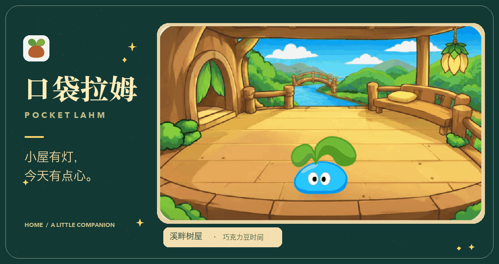</a>

<h1 align="center">口袋拉姆 · Pocket Lahm</h1>

小屋里，有个小家伙在等你。 吃点心、去旅行，把日子慢慢记进手记

<a href="https://github.com/andyforfun168/Lahm-pocket/releases/tag/v28.0">V28.0 更新公告</a>　 ·　 <a href="#手机安装与更新">手机安装与更新</a>

## ✦ V28.0，把小风景珍藏起来

**给每一种颜色的小拉姆，一本自己的织布收藏册。** 小屋与手记里的入口换成实体小册子：细细的布纹、撞色缝线和小布贴，跟随拉姆当前体色。轻点图标先看封面，再点封面翻开。

<table>
<tr>
<td width="50%" align="center">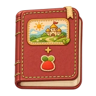 <b>番茄红</b></td>
<td width="50%" align="center">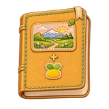 <b>奶油黄</b></td>
</tr>
<tr>
<td width="50%" align="center">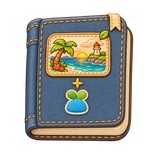 <b>天空蓝</b></td>
<td width="50%" align="center">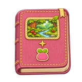 <b>莓莓粉</b></td>
</tr>
</table>

每页四张旅行卡，最多十页，特别的小风景会优先收好；再次遇见同一条珍藏见闻，会换成最新时刻的风景。完整见闻汇总一直保留。还在小花盆里的拉姆也有一本空册子，可以先把期待收进去。

**还有一些更特别的黄金见闻，藏在熟悉的小路上。** 先留一点神秘，等拉姆亲自讲给你听。

**轻度陪伴，也能稳稳长大。** 每健康陪伴 1 小时自动获得 10 点成长值，离线也会累计；高级到超级所需成长值降为 4,000，其他成长、陪伴时间与课程条件保持。旧玩家保留已长成的阶段与原有成长，并按可靠记录一次补足当前阶段；已有成长更高时完整保留，不重复叠加。

**把字调到舒服的大小。** 设置新增「文字大小」的标准／较大两档；任务说明和陪伴卡更易读。餐厅换上手写木牌，今日排班一眼能看清。手记先展示最新三条纪念和最近四张旅行卡，早些的纪念可以展开，更多风景留在收藏册。

<table>
<tr>
<td width="50%" align="center" valign="top">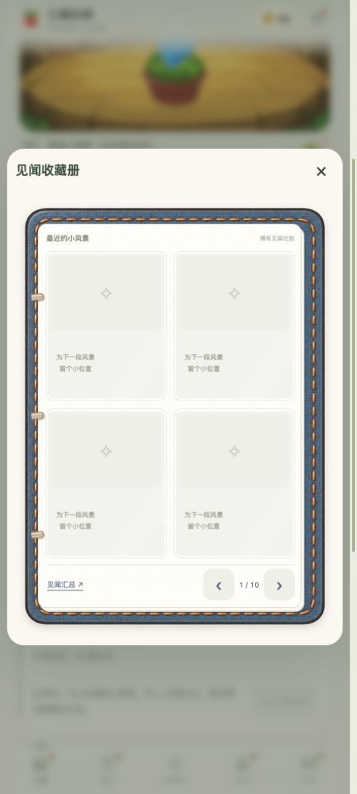</td>
<td width="50%" align="center" valign="top">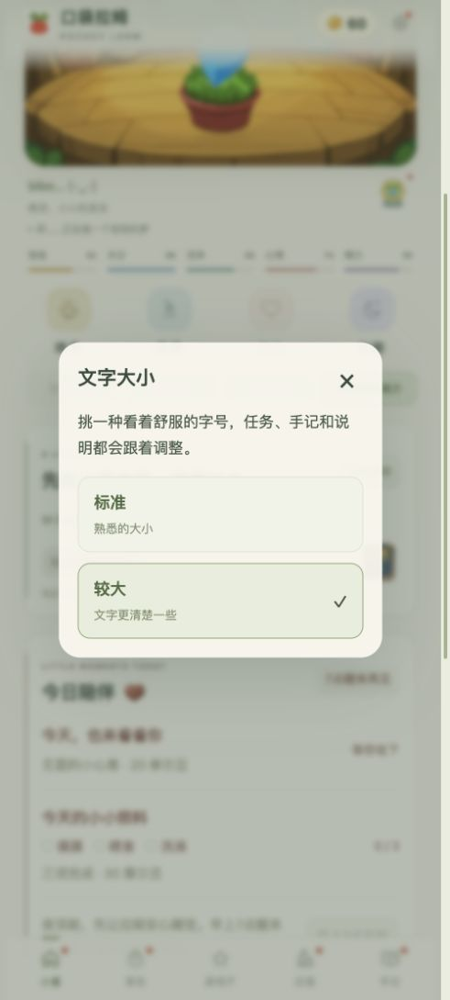</td>
</tr>
</table>

**原来的陪伴，完整带进新版。** 继续使用原入口，成长、背包、课程、奖章和手记都会保留。每天凌晨 4 点后的首次上线检查版本，发现更新会居中提醒；下载完成选择「保存进度并打开新版」，进入后即可查看更新说明。新增设置会用独立红点指路。

[查看 V28.0 更新公告与下载](https://github.com/andyforfun168/Lahm-pocket/releases/tag/v28.0)

## ✦ V27.0，小屋的新手记

主页旅行模块多了一本随手能翻开的见闻收藏册。轻点右侧的小册子，就能看看走过的地方、收好的见闻；打工、上课时也可以查看，旅行途中仍保留原来的风景画版式。主页与手记两个入口，都在屏幕中央展开同一本圆角收藏册。

旅行来信、阅读、改名药水提示、课程详情与更新说明等弹窗，底部独立按钮已通栏居中；双按钮确认也排成等宽两列。旅行模块原有的行距、卡片高度和按钮位置保持原样。

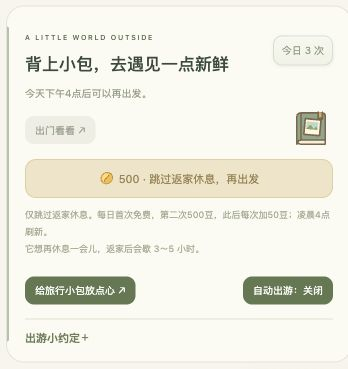

[查看 V27.0 更新公告与下载](https://github.com/andyforfun168/Lahm-pocket/releases/tag/v27.0)

四种颜色的小拉姆，都有更多话想说了。吃点心、喝饮料、洗香香、旅行和领奖等23类手记扩充为432种表达；会避开近期写过的句式，喝饮料也会用对说法。购物手记按实际商品记录。新手记跟随当前体色，旧记录留着原样。

学院、餐厅和淘淘乐街的文案与场景间距已对齐。奖章、旅行来信、改名与确认说明的居中弹窗，统一为四角圆角矩形；长内容可以在框内滚动。改名仍会核对原名和新名，最终确认才使用药水。

<table>
<tr>
<td width="50%" align="center" valign="top">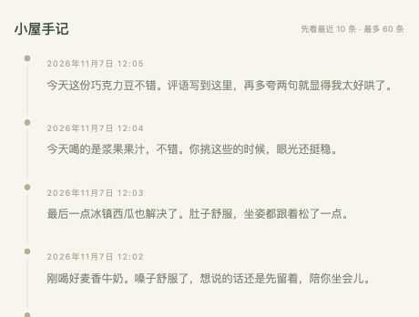</td>
<td width="50%" align="center" valign="top">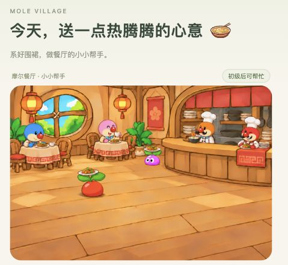</td>
</tr>
</table>

**排版补充修复：** 居中的奖章、改名弹窗改为四角圆润的矩形框；今日陪伴的三项照料圆圈与文字对齐。

**补充修复：** 自动出游精力门槛改为 ≥55，手动出游仍为 ≥35。奖章详情、收藏与更换弹窗居中，收藏页写上拉姆的名字。改名弹窗也居中显示，核对原名、新名并再次确认后，才会使用一瓶药水。

**V27.0 体验修复已补充：** 更新公告不再被重复下载引导盖住；新增设置有独立红点，旅行小贴士与来信、稀有见闻、奖章分别提醒。中级拉姆喝雪顶椰汁前会先向左走到边界，也补好了身体底部的颜色。

小屋添了几枚淡彩书签，日常陪伴、旅行和小任务更容易找到。喜欢熟悉的叶绿色，也能在「设置 → 小屋主题」切回经典小屋；新老玩家都能通过红点找到新设置，查看后小红点就会收好。

<table>
<tr>
<td width="50%" align="center" valign="top">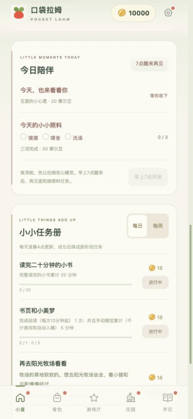</td>
<td width="50%" align="center" valign="top">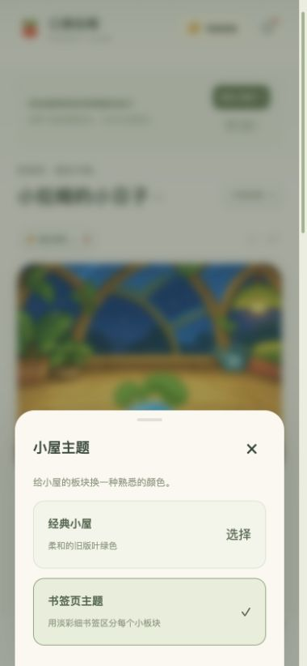</td>
</tr>
</table>

**今天，想和你一起做四件小事。** 长大后的拉姆每天有两件普通任务、一趟指定目的地旅行和一则购物小故事。去牧场坐坐，或替葡萄准备一瓶课间牛奶；购买故事里的物品就算完成，无需额外送礼。每日和每周各有 10 条目的地、10 条购物故事，分类展示一轮后重新洗牌。种子期保留独立的日常小约定。

**这次，让拉姆自己记下心情。** 红色热情开朗，黄色勇敢体贴，蓝色冷酷耍帅，粉色温柔可爱。同一件小事，也有它自己的说法；新手记跟随当前体色，过去写下的那一页保留原来的语气。

| 番茄红 · 热情开朗 | 奶油黄 · 勇敢体贴 | 天空蓝 · 冷酷耍帅 | 莓莓粉 · 温柔可爱 |
| :---: | :---: | :---: | :---: |
|  |  |  |  |

| 睡饱饱 Plus | 足球小子 | 天下第一好 |
| :---: | :---: | :---: |
|  |  |  |

获得奖章会亮起红点，也会留下一篇小屋手记。旅行来信和单篇见闻在屏幕中央展开，稀有明信片染上浅紫底；轻点明信片下半部就能读信，听过后再点按钮即可合上。

四款小游戏提示更清楚，小卖部多了一枚手绘「50% off」小吊牌。改名药水首瓶 500 豆，之后每瓶 5000 豆；见面心意是 20 豆，完成三项照料还有 30 豆。设置里也能一键开启或停止音乐。

## ✦ V26.0，回小屋，有封信等你

[查看 V26.0 更新公告并下载](https://github.com/andyforfun168/Lahm-pocket/releases/tag/v26.0)

结业啦！去校长办公室找菩提大伯和葡萄，听听他们为中文、英文和魔法入门准备的三份不同祝贺。学会了本领，回小屋也能露一手。

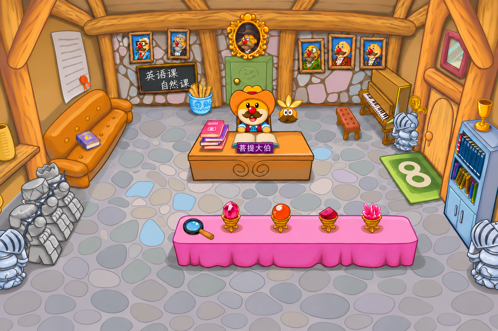

背上小包去庄园走走吧。傍晚的浆果丛林多了两只小兔，夜里的猪猪回了棚，雪山和海边留了一片星空。久一点没见，回小屋还能拆开拉姆的近况来信。

挑好点心或浴液，就能直接看拉姆吃饭、洗澡。要是它有点不舒服，小屋也会提醒你去看看它。

也看看以前的溪畔树屋封面

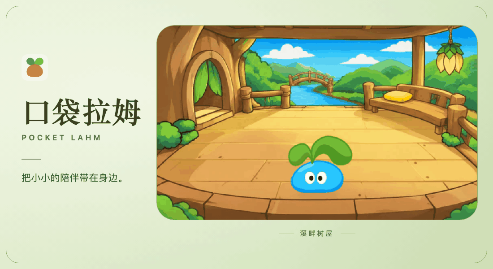

## ✦ V25.7，月光、远行与小小照料

[查看 V25.7 更新公告并下载](https://github.com/andyforfun168/Lahm-pocket/releases/tag/v25.7)

餐厅打烊后，两盏灯笼都熄了。月光从圆窗斜斜落下，在木地板上留下柔和的十字窗影。

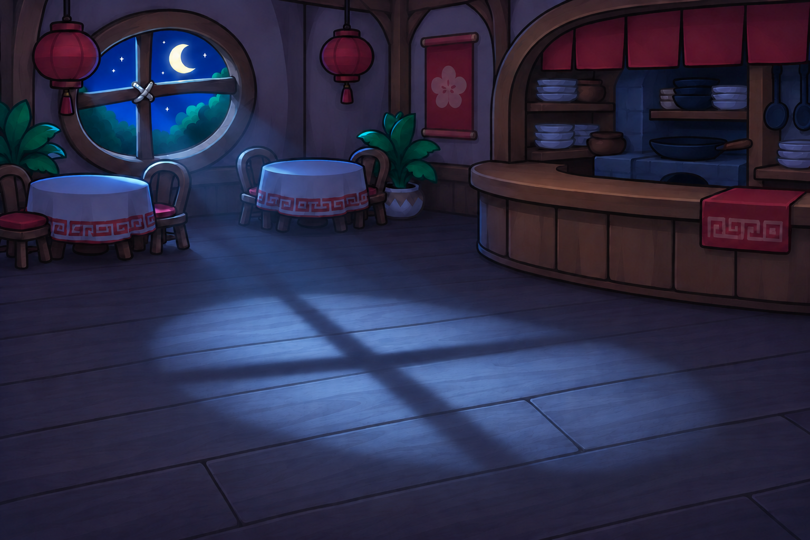

旅行途中，风景会跟着天色变换。明信片会定格返家时的光线，稀有见闻用紫色小标记，礼物和摩尔豆用图标与数量显示。拉姆渐渐长大，也能带回更多礼物。

| 傍晚的浆果丛林 | 入夜后的海边小镇 |
| --- | --- |
|  |  |

- 小屋增加水分状态，设置里可以查看健康详情。喂食、洗澡直达对应的商店分类，商品卡也能看到背包数量。
- 四款小游戏每局 5 摩尔豆，开局前会确认。每天共享 5 次达标奖励，每次 15 摩尔豆。翻翻乐会记录完成四对的最快用时。

## ✦ V25.5，把暖暖的小日子装进口袋

[查看 V25.5 更新公告](https://github.com/andyforfun168/Lahm-pocket/releases/tag/v25.5)

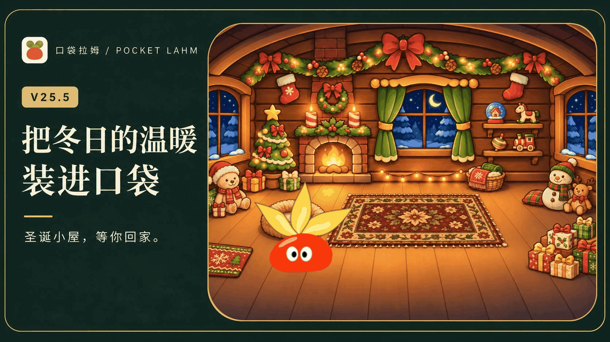

新增圣诞小屋背景，陪你迎接即将到来的圣诞。壁炉燃着暖光，窗边落着雪，小熊和礼物已经准备好，等你和拉姆一起，把冬日过成温暖的小日子。

不同时间段，还会遇见不同的温馨时刻。窗外的天色、屋里的灯光，都留待你亲自发现。

随着拉姆长大，晨光书房、溪畔树屋和圣诞小屋会陆续开放。用日常积攒的摩尔豆解锁喜欢的风景，让每次回家都有新的期待。

## ✦ 学会的本领，值得好好收藏

语言、英文和魔术的结业证书，带着各自的小图标与蓝、粉、紫绶带，一起收进木质展示柜。学会魔术盒变身后，拉姆偶尔也会自己变个小魔术，给安静的小屋添一份惊喜。

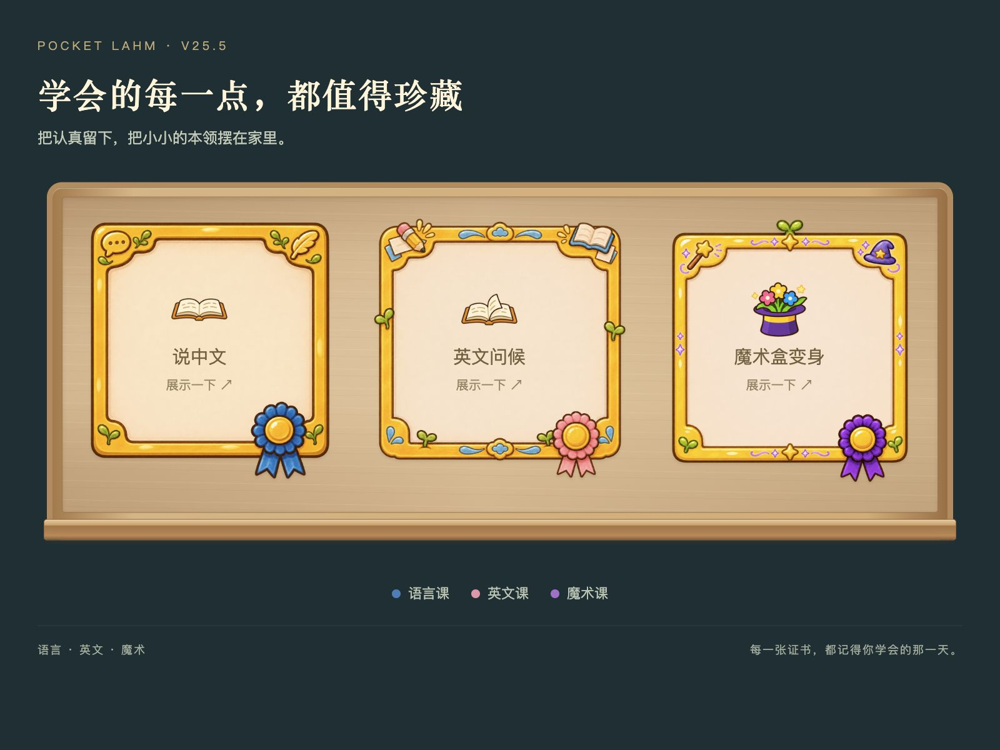

待机时会追着蝴蝶看看、迈几步小步子，互动也能遇见新加入的五组玩耍动作。小屋里的七个动作可以自己挑，没选满时会随机补齐，想换一组就再挑一次。

## ✦ 新篇开启，魔法阁楼开课啦

沿着木楼梯走上阁楼，翻开的魔法书、亮着光的水晶，还有等你上课的小老师，都准备好了。

从语言、英文和魔法入门学起，再走进火、水、木三系课堂。**一节一节学会本领，也一点一点长成自己的模样。**

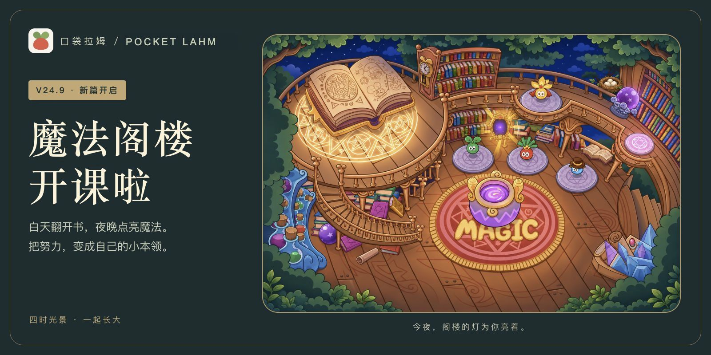

沿着木楼梯走进阁楼，听一堂新课，也看看夜色里悄悄亮起的魔法。还有一些只属于特定时刻的风景，等你和拉姆一起遇见。

## ✦ 同一座学院，四时的温柔

熟悉的树屋、校门和草地，从白昼的绿意，一路走到星夜的灯火。场景跟随设备当地时间变化，你过着自己的一天，拉姆也在同一片晨昏里生活。

<table>
<tr>
<td width="50%" align="center" valign="top">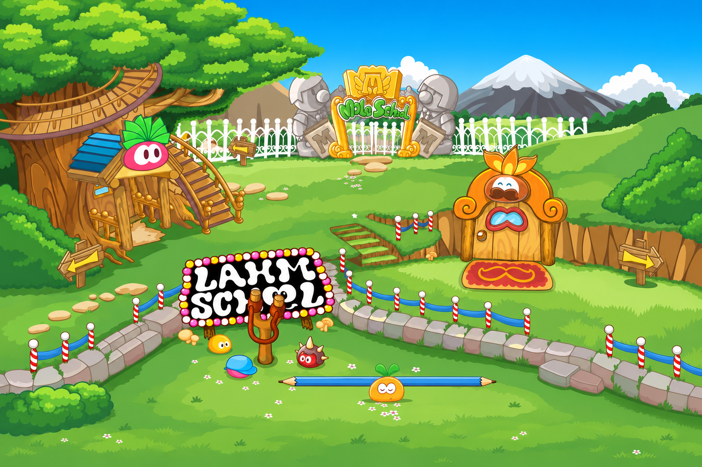</td>
<td width="50%" align="center" valign="top">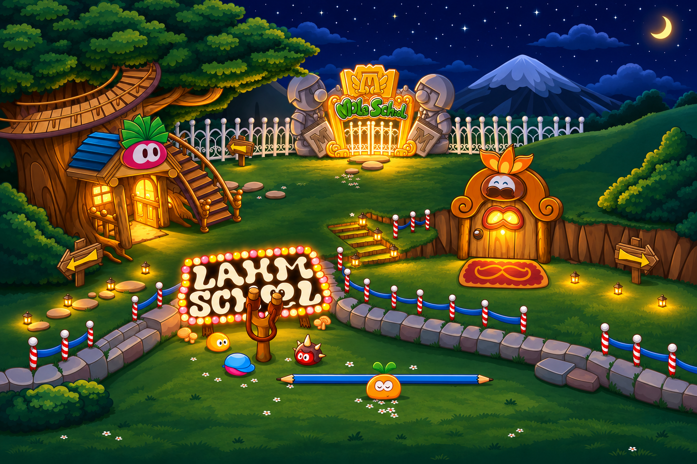</td>
</tr>
</table>

## ✦ 把努力，变成第一张证书

完成基础课后，去校长办公室找菩提大伯吧。葡萄也在那里，陪你收下这份肯定，把学会的小本领好好记进成长手册。

已经结业的课程，还可以回来当小助教，陪别人学一会儿，攒一点摩尔豆。夜深了就先休息，明天还有新的小期待。

这次，还有这些小变化

- 餐厅里的拉姆与餐盘比例更协调，洗澡物品说明在小屏幕上也能完整阅读。
- 自动出游默认开启，随时可以在小屋中调整。
- 学院、阁楼和办公室切换更流畅，画面比例统一。
- 重进学院时，先回到基础课程表；课程卡可以点开查看详情。
- 上课小贴士默认收起，领取证书与学会新本领时会有提醒。
- 游戏厅入口、翻翻乐说明和旅行准备按钮更清楚，小屋背景显示也已整理。

## 长大以后，魔法开始了

成长目标更贴近日常照料的节奏：每健康陪伴 1 小时自动获得 10 点成长值，离线也会累计，单次离线最多结算 24 小时。种子期需要积累 220 点，初级 2,500 点，中级 5,500 点，高级到超级改为 4,000 点阶段成长值。健康陪伴的时间与课程要求保留；已长成的阶段、本阶段原有成长和过去的记录都会留下。超级拉姆继续通过火、水、木三系课程，向神力阶段迈进。

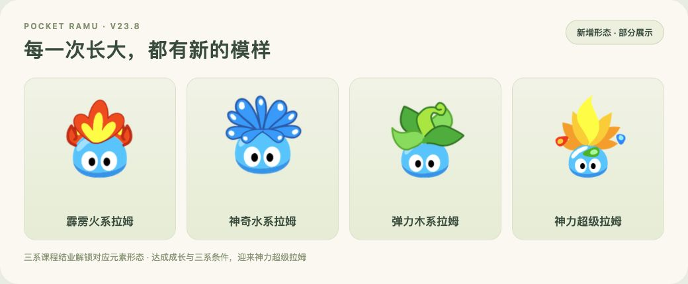

从小花盆里的种子开始，经历初级、中级、高级与超级阶段，再向神力超级拉姆迈进。成长值与健康陪伴一起积累，学会的本领和走过的日子都会留下来。

超级阶段完成对应课程后，可切换火、水、木系形态；成长为神力超级拉姆后，还能自由回到初级、中级、高级的模样。换外观不会重置成长与课程。

## 小屋日常，也有自己的动作

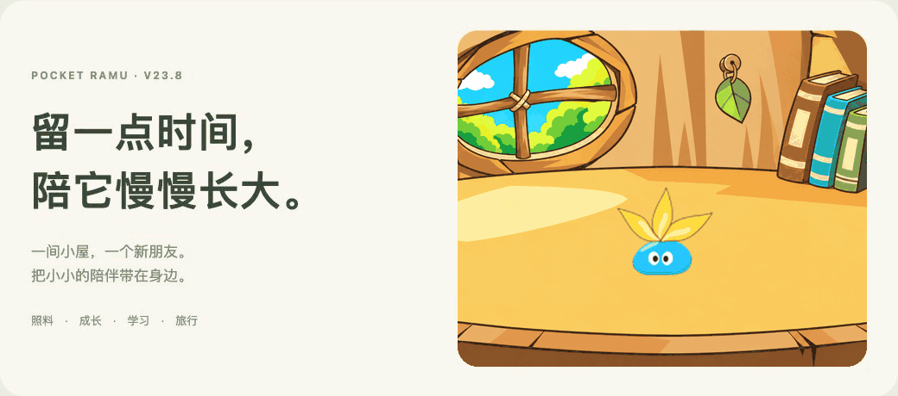

喂一口点心、喝一瓶牛奶，或是陪它踢踢球、看看蝴蝶。每一次小小的照料，都有不同的动作和表情。

<table><tr><td align="center" width="50%">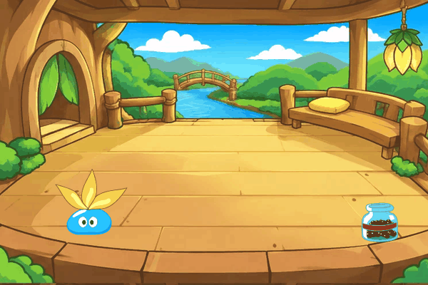 <b>一罐巧克力豆，吃得很认真</b> 超级拉姆 · 巧克力豆</td><td align="center" width="50%">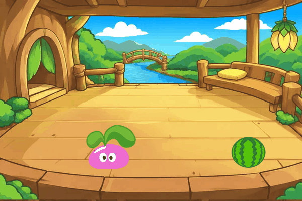 <b>抱住西瓜，咬一口夏天</b> 中级拉姆 · 冰镇西瓜</td></tr><tr><td align="center" width="50%">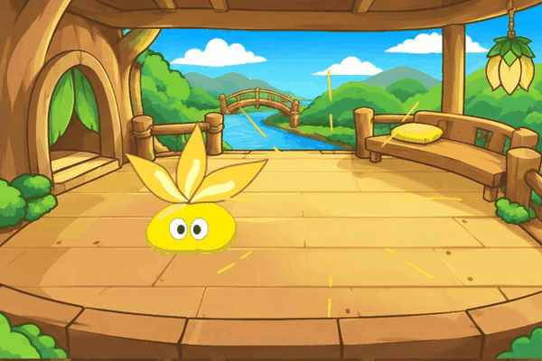 <b>软软的面包，慢慢尝</b> 超级拉姆 · 云朵面包</td><td align="center" width="50%">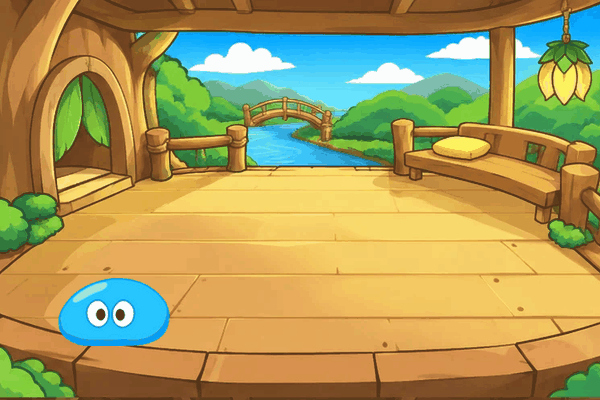 <b>喝完这瓶，再发一会儿呆</b> 初级拉姆 · 麦香牛奶</td></tr></table>

## 去庄园，过一个自己的小日子

<table><tr><td width="50%">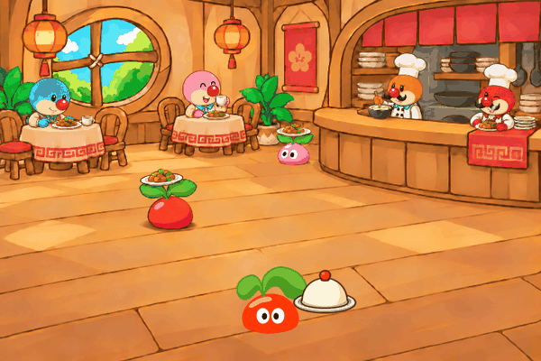 <b>认真帮个小忙</b> 去餐厅送餐，赚一点摩尔豆。</td><td width="50%">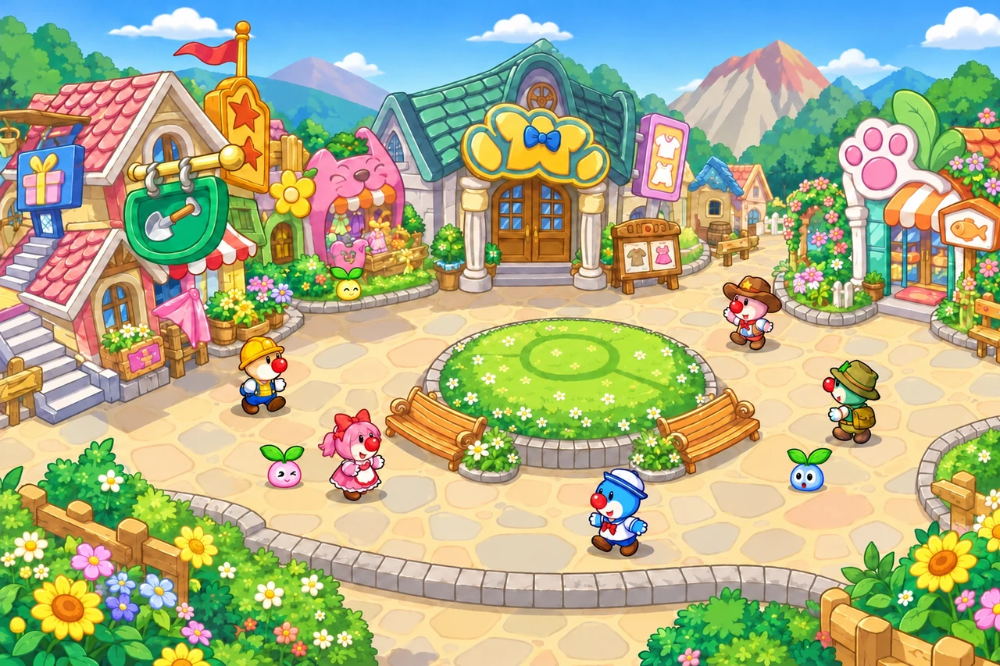 <b>沿着灯光，逛逛庄园</b> 挑一份点心，也挑一点小开心。</td></tr></table>

背上小包去旅行，从五个目的地带回礼物和见闻；挑一个小游戏，给普通的一天添点乐趣。成长、本领、远方和小小纪念，都慢慢写进你们的手记。

## 有些纪念，要一起发现

<table><tr><td align="center" width="25%"> <b>诞生奖章</b> 把第一次见面的心意留下。</td><td align="center" width="25%"> <b>睡饱饱</b> 好好休息，也值得被记住。</td><td align="center" width="25%"> <b>旅行家徽章</b> 把走过的远方，珍藏成纪念。</td><td align="center" width="25%"> <b>七日签到徽章</b> 连续七日，把陪伴留在小屋。</td></tr></table>

第一次见面的心意、睡饱后的美梦、旅行带回的足迹，还有连续七日的相伴，都能化作一枚小小纪念。更多徽章藏在陪伴与探索里，获得后可挑选最多三枚陈列在小屋。

## 手机安装与更新

1. 用 iPhone / iPad 的 **Safari** 打开 [游戏网址](https://andyforfun168.github.io/Lahm-pocket/)，选择“分享 → 添加到主屏幕”。
2. 从图标进入，在“设置 → 离线下载与更新”下载完整资源。
3. 看到离线就绪，就可以把拉姆装进口袋，离线也能陪伴。

**从旧入口搬家？** 先在旧图标中进入“设置 → 导出备份”保存进度，再用 Safari 打开上方的新游戏网址，导入备份并重新添加到主屏幕。首次从新图标进入后，请确认拉姆和进度已正确导入。

从 V28.0 起，每天凌晨 4 点后的首次上线会顺便检查版本，发现新版会在屏幕中央提醒；暂不更新后，次日仍会提醒尚未安装的新版本。也可随时在“设置 → 离线下载与更新”手动检查，下载后选择“保存进度并打开新版”。更新完成会说明这次更新了什么，同一大版本的更新说明会累计保留。沿用原来的游戏入口即可继续旧存档，无需清除网站数据。

下载与存档小提示

完整离线包大小以游戏内显示为准。下载时保持页面在前台，中断后可以继续。首次下载完成后，点“下载好了，进入游戏”；更新完成后，点“保存进度并打开新版”。

存档保存在当前设备的浏览器或主屏幕入口中，不自动跨设备同步。更换设备、入口或清理网站数据前，请先在设置中导出备份。

<b>慢慢长大，慢慢学会。 愿忙完一天的你，也有一盏小小的灯在等着。</b>

## 小屋还会继续长大

后续会陆续带来更多拉姆的点心、更多可以出发的摩尔庄园风景，也会慢慢加入新的互动和玩法。希望每一次回到小屋，都能有一点新鲜，也有熟悉的安心。愿你喜欢这份小小的陪伴，和拉姆一起，继续发现庄园里的好日子。同时也诚邀各位小摩尔提供不同的建议或意见，一同为我们的小拉姆们创造一个更温暖更舒适的环境。

## 关于这份陪伴

感谢摩尔庄园，曾为无数人的童年留下一处温暖的港湾。在庄园里度过的日子、拉姆的每一帧动画、每一次小小互动，都装着珍贵的回忆。小时候总觉得，如果能真正拥有一只自己的拉姆，陪它吃饭、玩耍、慢慢长大，一定是一件很幸福的事。

以前的小摩尔，如今也长大了。这个小项目想延续的，就是那份简单的幸福与陪伴。愿意为这个如梦的小世界付出一点努力，让熟悉的回忆在忙碌的生活里，仍有一个可以回来的地方。

本作为以《摩尔庄园》页游拉姆形象为主题的非官方个人养成小游戏，与摩尔庄园官方无关联。角色、名称、音乐及原始素材权益归各自权利人所有，部分场景与演出配件使用生成插画。感谢 [mole-baby](https://github.com/Vinci-217/mole-baby) 的素材整理；口袋拉姆与其为独立项目。
