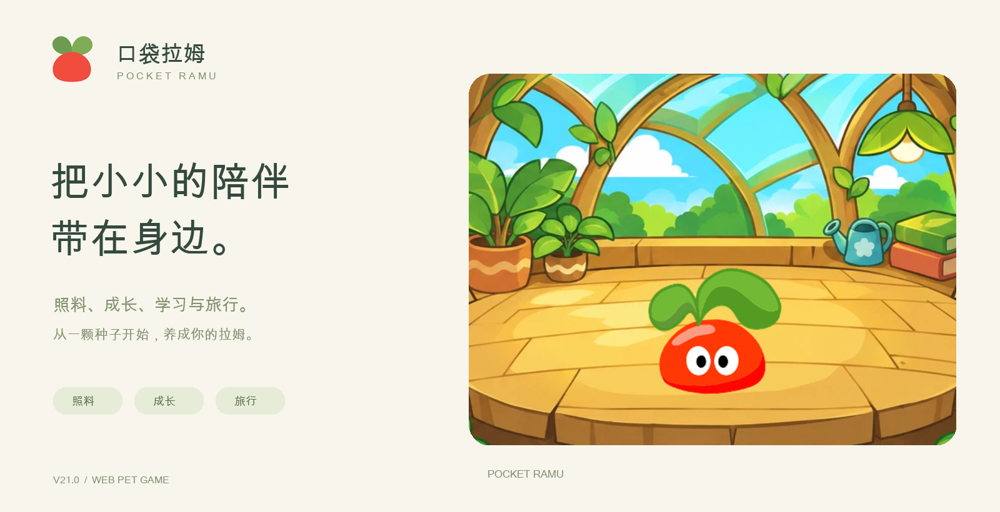

# 口袋拉姆 V21.0

## V21.0 更新内容

每日凌晨4点刷新，夜间1:30–7:00休息；任务使用拉姆的名字。

- 庄园入口依次为学院、餐厅、淘淘乐街；我的本领移入学院，小卖部移至淘淘乐街。背包仅显示已拥有的物品，仍可一键前往小卖部。
- 餐厅、学院和淘淘乐街根据设备当地时间切换光影：16:00 黄昏、20:00 夜晚。深夜睡眠时餐厅切换为空景。
- 学院增加不同颜色的拉姆学生；玩家拉姆不在学院时显示安静场景。
- 节奏拍手按绿色区域判定，成功后移动加快、判定区域缩短。
- 小游戏奖励需达到门槛：接星星8分、翻翻乐4对、节奏拍手5次、点球3球。未达标不扣每日奖励次数。
- 种子期仅可居住在星光花房；成为初级拉姆后开放其他风景，未解锁的风景不显示预览。

[开始游戏](https://andyforfun168.github.io/ramu-pocket/)

从原入口进入设置 → 离线下载与更新 → 检查更新，下载后保存进度并打开新版。

素材来自《摩尔庄园》页游。本作为非官方养成小游戏。

## 淘淘乐街

<table><tr><td></td><td></td></tr></table>
