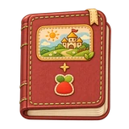
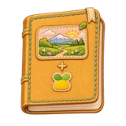
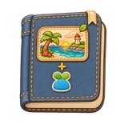
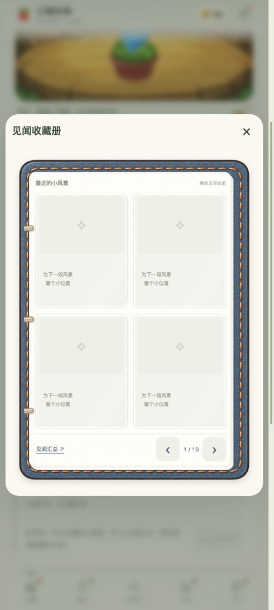
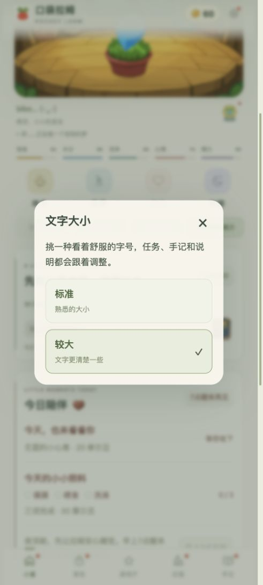

# V28.0 · 把小风景珍藏起来

[开始游戏](https://andyforfun168.github.io/Lahm-pocket/) · [完整介绍与往期内容](https://github.com/andyforfun168/Lahm-pocket#readme)

给每一种颜色的小拉姆，一本自己的织布收藏册。细细的布纹、撞色缝线、风景布贴，都是小屋入口的同款小册子。

轻点图标先看封面，再点一下翻开。每页四张，最多十页；特别的风景优先收好，完整见闻汇总一直保留。还在小花盆里的小拉姆，也能先拥有一本空册子。

熟悉的小路，还藏着一些更特别的黄金见闻。把惊喜留在路上，等拉姆慢慢带回家。

## 陪伴慢一点，也能长大

每健康陪伴一小时自动获得 10 点成长值，离线也会累计，沿用单次离线 24 小时的结算上限。高级到超级所需成长值从 5,500 降至 4,000；其他阶段的成长、健康陪伴时间和课程要求保持。

旧玩家的成长与已长成的阶段保留。当前阶段按可靠的健康陪伴记录一次补足；原有成长更高时完整保留，不重复叠加。保持健康的日子都会算数，不必每天把所有活动做满。

## 读起来、点起来，更舒服

设置新增「文字大小」标准／较大两档，任务要求更简洁，陪伴卡和旅行按钮更易读。餐厅排班换上木牌与透明胶贴着的白便签。手记先看最新三条纪念与最近四张旅行卡，早些的纪念可展开，更多风景收在册子里。

<table>
<tr>
<td width="50%" align="center" valign="top"></td>
<td width="50%" align="center" valign="top"></td>
</tr>
</table>

拉姆留信中的入口会带到它正在工作的餐厅或正在上课的课堂；再点淘淘乐街会回到食物分类。旅行来信、收藏卡和手记的见闻类型与内容同步，欢迎回家会带回小屋看看拉姆。奖章也添了贴合主题的小句，留待获得后再慢慢读。

## 把原来的陪伴带进新版

继续使用原来的游戏入口，无需清除网站数据。成长、背包、课程、奖章、任务与手记继续保留。更新前也可以在设置中导出一份备份。

在「设置 → 离线下载与更新」检查并下载，完成后选择「保存进度并打开新版」。进入新版会显示更新说明，不会再被重复下载完成提示盖住。V28.0 起，每天凌晨 4 点后的首次上线检查一次版本；发现新版本会居中提醒，暂不更新后次日仍会再提示。更新介绍保留整个 28 系列的新增内容，下个大版本再开启新的一页。

## 本次补充修复

有卡、空卡和封面采用一致尺寸，翻页时收藏册不再忽长忽短；风景卡保留空卡位的宽松比例。原存档与收集进度继续保留。

## 下载

当前正常游玩版请选择 `pocket-lahm-web-v28.0-binder-fix.zip`，包含完整离线资源与卡册尺寸修复。原始 V28.0 包继续保留，作为历史下载。直接游玩请使用上方游戏入口。
